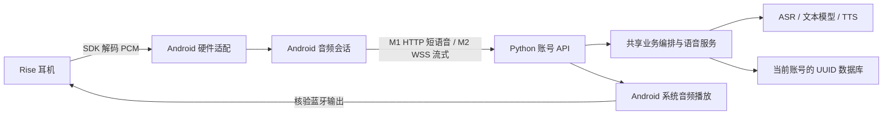

# Aidol Rise 安卓产品规划与开发交接

日期：2026-10-17。目标设备：viaim Rise 耳机 VI-A10，充电盒 VI-A10-B。目标客户端：现有 `android-app/`。

2026-10-17 需求深化：用户进一步要求围绕生活、工作、通勤打造旗舰 AI 耳机，并可随时通过耳机检索个人记忆。详见 [三场景与随时问记忆体验方案](headset-experience-plan.md)，包含跨模式记忆、工作中主动提问、锁屏优先级、通勤证据与验收指标。该文是后续实施建议，不表示相关功能已经交付，也不改变本页既有 M0/M1 代码与硬件验收事实。

同日开发增量已见 [实施状态](headset-experience-plan.md#14-后续开发第一批可靠性改进2026-10-17)：语音记忆闭环、全历史索引、显式锁屏会话和基础可靠性已进入代码；实机通过与后续阶段仍以验收记录区分。

同日追加用户范围：在 M0/M1 基础上明确要求完成 Rise 触控切换生活/工作/通勤、触控开始/结束/取消单轮对话、摘下暂停、断连停止、前台有界重连恢复就绪、电量与佩戴提醒，再统一推送 Git。这覆盖下文“首轮不扩入 M4”的触控相关限制，仅增加这些联动；不包含持续流式、后台监听、ANC、闪录或盒子能力。实现和真机确认按 `docs/acceptance.md` 逐项记录，SDK 枚举存在不代表设备已经上报事件。

用户最终指定触控规则：单击开始/结束发送，双击切模式，长按取消，三击不绑定。固件监听确认与真实手势验收分开记录。

用户随后追加简短操作播报：模式确认后播对应模式，开始录音前和结束排空后各播一句。使用内置固定语音与目标耳机路由，工作业务回答仍静音，不扩入同时采集播放或后台运行。

实施中用户最新确认（2026-10-17）：**只支持真机开发，后端界面仅“本地电脑服务（USB）”和“远端服务器”**。本地固定debug `127.0.0.1:8108`；不提供模拟器输入或`10.0.2.2`后端，旧模拟器偏好迁移时按新服务源重新读取登录状态。旧模拟器枚举仅供偏好迁移、旧采集源码仅作参考，不表示仍是产品入口。M1 SDK与停止排空要求及M2–M4范围不变，当前实施和实测以交接/验收文档为准。

Aidol 的主产品是连接 Rise 耳机的 Android App：用户通过耳机与助手交流，保存可追溯的个人记忆，在工作场景记录和整理内容，在通勤场景获取有依据的出行信息。Android 是本轮唯一持续建设的用户入口；Python 后端继续承担账号、模型调用、业务编排和数据存储。

当前资料足以启动 M0 和 M1，不需要先向厂商逐项提问。SDK 中已有 Rise 识别逻辑，接口足以设计接入；特定设备的固件、并发音频效果、按键与后台稳定性由真机验收确定。只有出现无法就绪、缺失回调、状态不一致等具体问题时，才携带脱敏日志向厂商询问。

本规划定义目标行为和实施顺序，不代表所列功能已完成。默认首次开发任务只实施 M0 和 M1；M2 至 M4 是后续里程碑，不自动扩入首轮。

## 最终目标与共同完成标准

最终交付包含两部分：一套可供用户使用的 Android 耳机产品，以及一套团队成员能独立运行、共同集成和复现问题的开发调试流程。现阶段优先完成耳机稳定收音、AI 对话和记忆，再达到持续工作记录与用户主动开启的锁屏会话；按键等硬件增强不能成为核心交付的前置条件。

| 目标 | 达到目标时的具体表现 | 主要里程碑 |
| --- | --- | --- |
| 用户无需电脑使用 | 手机安装 App、登录后连接 Rise，即可对话、查看记忆和工作记录 | M1 起形成基础体验，M2 M3 完善 |
| 交流与记录可靠 | 用户输入来自目标耳机，回复由目标耳机播放；有连续转写、明确会议边界和正确停止 | M1 M2 |
| 锁屏可用且可控 | 用户主动开始的会话在锁屏继续，通知中可停止，来电/断连有明确处理 | M3 |
| 每人能独立开发 | Windows 或 Mac 上运行本地后端，USB 真机 Run，耳机配对手机；账号与数据互不污染 | M0 |
| 多人能同时推进 | 模块有负责人，接口先约定，分支变更可独立审查，共用代码基线与 SDK 版本 | M0 起持续执行 |
| 问题能跨成员复现 | 反馈包含构建、环境、步骤和关联日志，可定位设备、App、网络、后端或供应商阶段 | M0 M1 起持续执行 |
| 集成结果可验证 | 在共享测试环境用独立账号验收，发布包能追溯源码与测试记录 | 每阶段 |

日常研发不要求打开网页。团队共享代码、契约、脱敏用例和验收记录；每人保有自己的本地环境与数据。模型供应商凭证配置在后端，日常用户无需持有。

## 1 产品范围

### 用户与使用方式

| 用户 | 使用方式 | 需要准备 |
| --- | --- | --- |
| 开发者 | Windows 或 Mac 运行本地后端，USB 连接安卓真机，耳机连接手机 | 开发环境、后端凭证、测试账号、耳机 |
| 内部体验者 | 安装 APK，登录部署好的服务，耳机连接手机 | 安卓手机、耳机、网络，无需电脑或供应商 Key |

开发时手机和电脑通过 USB 转发通信，不要求同一 Wi-Fi。正式使用时手机连接 HTTPS 后端，电脑无需运行。各开发者本地账号与数据库独立，数据不随 Git 同步；本地账号与部署环境账号也不互通。

### 本轮保留和新增

保留现有登录与账号恢复、文字对话、记忆编辑与来源、问记忆、工作纪要、行动项、通勤地图、设置、导出和清空功能。新增 Rise 设备连接与状态、SDK 收音、USB 开发入口和可用于联调的诊断信息。

项目已收窄为 `android-app/`、`app/`、`website/` 三个产品模块。旧 `web/`、`android-demo/`、`qwen_omni_demo/`、`web_duplex_demo/` 已退出当前源码，旧单用户接口与浏览器音频运行链路一并移除。硬件诊断留在主 App 的 debug 能力中；供应商凭证继续只在后端，官方 `demo_6_7.zip` 仍作为固定 SDK 导入来源。

首轮不实现全天候自动监听、唤醒词、通话录音产品、ANC 控制、离线 AI、多说话人声纹识别、自动发送消息或盒子全功能。普通系统蓝牙可作为用户明确选择的兼容输入，不能在 SDK 失败时静默回退。

## 2 现状与已确认依据

规划基于 `main` 的 `5fa8a55` 及当前未提交工作区。该提交号本身不包含所有已观察到的本地开发能力；开始开发前必须检查实际文件与 `git status`，不能重置、覆盖或笼统提交已有改动。

| 项目 | 当前事实 | 对设计的影响 |
| --- | --- | --- |
| 主 App | 原生 Java，已有对话、记忆、工作、通勤、我的五个入口 | 在既有项目增量实现，不重建客户端或引入跨平台框架 |
| 当前录音 | 前台录完再上传，单轮最多 60 秒 | M1 保持短语音模式，不能标为实时双工或完整长会议 |
| 连续轮次 | 回复处理和播放结束后才开启下一轮 | 存在收音空隙，M2 才解决持续采集 |
| 当前 SDK | 主 App 尚未集成厂商 AAR | 需要新增硬件适配，而非只添加依赖 |
| Rise 识别 | 6.7 AAR 的 `AuraDevice.isEarbudsName` 匹配 `viaim rise`；`identify` 通过 `A10L`、`A10R` SN 前缀识别耳机类型 6510 | 采用 Aura/Rise 接入分支；名称匹配不代替真实握手与功能验收 |
| 官方融合录音 | `startFusionRecord` 返回状态、场景、麦克风和扬声器两路解码 PCM | 正常 AI 输入只取麦克风通道 |
| hosted API | 独立账号与 UUID 数据库；仅提供已定义的账号 REST 契约 | M1 复用现有 API，M2 新建账号鉴权的实时契约 |
| 原生库 | AAR 含 arm64-v8a 与 armeabi-v7a，无 x86 库 | SDK 用 ARM 真机验证，模拟器已退出当前入口 |

官方文档将融合录音数据定义为 16 kHz、16 bit、单声道 PCM，`channel=1` 是采集到的扬声器音频，`channel=2` 是麦克风，`channel=255` 是结束标志。扬声器通道不是 TTS 下发接口。适配层仍需核对实际字节序、数据长度与回调行为，以满足后端的小端 PCM16 契约。

### 设备能力边界

| 能力 | 规划位置 | 使用条件 |
| --- | --- | --- |
| Rise 融合收音 | M1 核心 | 初始化完成、通信就绪、真实麦克风数据验证 |
| 电量与佩戴状态 | M1 基础展示 | 只展示实际上报属性，未上报显示未知 |
| 播放与采集并发 | M2 | 真实播放路由、回声与插话测试通过 |
| 6.7 按键和头部动作 | M4，之前仅 debug 诊断 | 测试接口的固件支持及产品适用性确认 |
| 耳机闪录导入 | M4 | 按型号检查下载、完整性和索引语义 |
| 盒子实时录音 | M4 可选 | 耳机查得关联身份地址，再按 SDK 流程切换连接 |
| 盒内闪录管理 | 不纳入当前版本 | 文档明确当前盒子固件不支持列表、下载、删除和清空 |

6.7 测试事件采用 0x560F，不等同于 0x5D07 普通按键协议。事件枚举存在不等于固件会上报，注册也未单独开启 IMU VAD。首轮正常对话不得依赖这些事件。

## 3 页面与核心体验

### 页面安排

首轮保留现有五个入口，避免设备接入与导航重做相互干扰。设备详情放在“我的”，对话页增加简洁设备状态与快捷入口。

| 页面 | 用户需要完成的事 | 首轮调整 |
| --- | --- | --- |
| 对话 | 文字交流、开始录音、结束发送、取消、查看回复 | 增加耳机就绪状态、明确的录音阶段和异常提示 |
| 记忆 | 查找、编辑、收藏、删除、追溯来源、问记忆 | 保留功能，验证 SDK 输入形成的记忆仍有正确归属 |
| 工作 | 安静记录、生成纪要、查看和完成行动项 | M1 明示分段记录；M2 增加单场会议的开始、结束与历史 |
| 通勤 | 目的地、路线、位置、周边、天气和提醒草稿 | 保留，暂不增加后台定位或实时公交承诺 |
| 我的 | 账号、偏好、设备、数据管理 | 新增设备详情；debug 独有后端、输入来源和诊断入口 |

普通页面显示“正在连接耳机”“耳机已就绪”“正在聆听”“正在结束录音”“正在识别”“正在回复”等可理解状态。SPP、GAIA、PCM、帧计数等仅出现在开发诊断中。

### 第一次使用

1. 登录或注册目标后端账号；先确认文字对话能工作。
2. 在手机系统完成耳机配对，按当前系统和操作申请必要权限；拒绝权限时仍可使用文字功能。
3. App 初始化 SDK 并连接耳机，等待通信就绪；分别显示设备状态和音频输入输出状态。
4. 用户主动开始短录音，结束后显示识别文字与回复，并在已核验的耳机输出中播放。
5. 用户在记忆页确认保存内容和来源。工作模式仅记录，不自动播放回答。

### 操作语义

| 操作或事件 | M1 必须行为 |
| --- | --- |
| 开始录音 | 就绪后启动唯一录音会话，真实开始后显示录音状态 |
| 结束并发送 | 请求 SDK 停止，接收有效尾帧，确认结束并排空队列后只提交一次 |
| 取消 | 立即停止接纳本轮输入、取消待执行请求与播放，清理录音；未提交的音频丢弃 |
| 已提交后取消 | 尽力取消客户端网络任务，不声称能撤销服务端已完成的数据保存 |
| 超时或停止未确认 | 停止自动接续，提示恢复或重连，不上传成一段看似完整的成功录音 |
| 来电或焦点丢失 | 暂停 AI 会话并清理，不自动开始系统通话录音 |
| 耳机断连 | 停止采集和播放，说明原因；不切到手机麦克风或扬声器继续 |
| 页面离开或锁屏 | M1 沿用前台边界，停止自动接续并清理；M3 才改变后台行为 |
| 网络失败 | 保留明确错误和已经得到的文字结果，不默默重复提交整段音频 |
| 切后端或退出账号 | 清理旧会话，按目标源地址读取登录状态，不串用账号或录音 |

生活、工作、通勤继续共用后端模式决策，手动选择优先。模式变更不是开麦授权；程序启动、登录成功、重连或服务器事件不得自行启动新录音。

## 4 技术职责与音频设计



硬件代码留在 `android-app/` 的独立包，例如 `hardware/` 与 `hardware/vendor/`。厂商协议不进入后端；后端供应商协议继续在 `app/providers/`，会话与业务决策在 `app/services/`，鉴权和生命周期在 `app/main.py`，事务在 `app/storage.py`。每个账号使用隔离上下文，共用同一套编排逻辑，不增加多个自主决策 Agent。

### Android 模块建议

| 模块 | 职责 |
| --- | --- |
| `HeadsetController` | SDK 唯一所有者，初始化、连接、设备类型、状态查询和监听生命周期 |
| `VendorCaptureSource` | 将融合录音转换为统一麦克风 PCM；过滤扬声器和结束标志 |
| 录音源工厂 | 明确选择 SDK 或系统蓝牙，实现可测试的注入 |
| 会话控制器 | 开始、排空、取消、上传、播放、异常及会话代次隔离 |
| `ReplyPlayer` | 系统音频焦点、媒体播放、真实输出核验和取消 |
| 设备诊断 | 展示握手、实际来源、错误、音频计数和阶段耗时，不泄露凭证 |

这是职责建议，可以沿用现有类名，不要求一次性重写所有 UI 或服务。

### 必须先处理的接口问题

M1 已将 `HostedSession` 改为注入录音源与目标输出验证，显式区分 `BLUETOOTH` 与 `RISE_SDK`。旧 EMULATOR 偏好仅用于迁移，会话不允许启动该来源。后续变更继续分别检查输入来源、播放策略和权限需求，不能因“不是系统蓝牙”就放行默认采集或扬声器。

`CaptureSource.stop()` 当前没有结束确认。扩展为异步完成契约，例如结束回调或 Future，并区分正常结束与取消。现有 `HostedSession.stopRecording()` 立即设 `stopped=true`，PCM 回调随后全部丢弃；该逻辑不能直接用于 SDK。

正常结束采用 `RECORDING → STOP_REQUESTED → DRAINING → ENDED`：停止请求后仍接纳本轮合法尾帧；融合录音以 `onState("idle", ...)` 确认 SDK 结束，再排空适配层队列，最终形成一次上传快照。`isEnd()` 是结束标记，不得作为音频写入；它与状态回调的具体关系按该 API 的文档和真机结果处理。取消走独立终止路径，立即禁收并丢弃未提交缓冲，同时完成设备清理。

每轮使用 generation/session ID，旧会话迟到回调不得进入新会话。停止、取消、释放和反注册都要幂等。停止确认设有界超时；超时不直接启动下一轮，需要明确恢复设备状态。60 秒及请求体上限继续生效，不能为了等尾帧无限增长缓冲。

停止与排空预算包含在录音总上限内，应接近上限时提前请求停止。若仍超限，不得沿用 `Math.min` 静默截断并标为完整录音，应明确失败并丢弃未提交缓冲。测试覆盖达到时限、停止延迟与尾帧超限。

### 连接与数据规则

- 连接状态区分未连接、连接中、传输已连接、通信就绪、断开中、错误。等待初始化完成及 `onConnectReady` 后再发查询或录音命令。
- SDK 设备管理生命周期长于一次语音轮次，不要每轮重建 SDK 或重复注册全局回调。
- `isConnectSPP()` 不是通用就绪判断；盒子为 BLE，使用 SDK 的设备连接与就绪接口。
- SDK 回调复制所需音频缓冲后进入有上限的处理队列，不阻塞回调线程；队列满明确失败，不能无限缓存或悄悄丢数据。
- 麦克风输入规范化为 16 kHz、单声道、小端 PCM16、无 WAV 头。M1 不将扬声器通道混入 ASR，不自行再解码已经解码的 PCM。
- 默认不把原始音频写文件。诊断记录实际字节数、持续时间、队列状态和耗时；固定格式连续有效流理论为 32000 字节/秒，窗口统计只用于发现异常，不将速度单独当作录音完整性证明。
- 播放继续使用 Android 音频系统。SDK 已连接不证明播放路由正确；多个蓝牙输出存在时，不能把任意蓝牙设备当作目标 Rise。
- 电量 0xFF、未上报属性、位置未知要保持未知。位置编码 0 不能作为物理盒盖已关闭的确认；不根据上报耳侧推断主从。
- 设备切换后重新绑定状态观察者。SDK 的单例和测试监听只能有一个明确所有者。

## 5 开发里程碑

### M0 统一 USB 真机开发基线

目标：同事取得完整代码后，能够独立搭建本地后端与真机 App。

1. 检查已有未提交修改和新增文件，建立本次变更清单，不撤销其他工作。需要新分支时默认 `codex/` 前缀，最终按团队流程共享到 `main`。
2. 后端 UI 仅“本地电脑服务”和“远端服务器”两项，迁移旧偏好为 USB 本地；输入来源与后端独立。
3. USB 地址固定 `http://127.0.0.1:8108`，仅 debug 允许该 HTTP 源；`10.0.2.2:8108` 已拒绝，release 保持 HTTPS 与证书验证。
4. 保留精确服务源地址隔离登录状态。旧模拟器源凭据不复制到 USB 源，也不向新源发送旧 Token；本地与远端分别登录。
5. 使用 `start-android-backend.ps1` / `start-android-backend.sh` 启动 `create_hosted_app`，继续监听电脑回环地址 8108、使用 `data/android-local/`。统一使用账号后端，不开放全部网卡解决 USB 问题。
6. 文档加入 USB 调试授权、`adb devices`、`adb reverse tcp:8108 tcp:8108`、重连后检查转发，以及多手机时通过 `adb -s <serial>` 指定目标。
7. 可增加显式开发重载选项，默认关闭，不改变部署启动。重载会中断进行中的请求，不能承诺无缝会话。

验收：debug 两个本地地址允许、release 拒绝 HTTP；切换后端账号不串用；本地注册与文字请求可用；Windows 和 Mac 的实际验证分别记录，未获得某平台设备则明确待验，不伪造通过。

M0 必须至少进行一次 USB 安卓真机测试：选择 USB 本地后端，关闭手机 Wi-Fi 和移动数据，完成健康检查、注册登录及文字请求；移除 reverse 后新建网络连接应失败，恢复转发后可重新请求。模拟器或电脑直接访问后端不能代替此项。

### M1 Rise SDK 短语音闭环

目标：稳定完成“Rise 麦克风 → 后端识别与记忆 → 耳机回复”，第一版可由他人复现。

1. 引入唯一版本 `headsetSdk-release-6.7.aar` 与官方需要的 RxAndroidBle、RxJava2、RxAndroid、JNA、Gson 依赖，处理冲突和 native packaging。不要复制 Demo 的签名、应用配置或整套旧网络依赖；保留 App 自己使用的 OkHttp。
2. 不改变现有 JDK 17、SDK 35 基线以迁就 Demo；按实际错误处理兼容性。只在用户明确选择 Rise 并连接目标时初始化 SDK，保留 ARM 原生库，不能以移除 ARM 支持解决构建问题。先在 debug 验证 Rise 来源，通过真机门槛后再调整 release 默认策略，不能把未验证 SDK 自动设为发布版唯一可用路径。
3. 按 Android 版本补齐实际需要的蓝牙扫描、连接及录音权限；初始化使用 Application Context。发布混淆开启时应用官方 keep 规则并验证。
4. 完成硬件模块、录音源选择和异步停止契约；M1 正常回复为先停止采集再播放，不实现播放中自动插话。
5. 复用 `POST /v1/voice` 与 `POST /v1/speech`：前者最多 1920000 字节原始 PCM，后者返回 24 kHz 单声道 PCM16 WAV。不改变既有业务响应或另建一套记忆逻辑。
6. 保留请求幂等 ID。同一已完成录音重试保持原 ID 与音频；409 或结果未知时先查询状态/历史，不自动换 ID 重放。
7. 加设备状态、开始/结束/取消反馈、错误恢复和 debug 诊断。修正与真实行为不符的提示，例如不能把“关闭转写保存”描述为“不再保存任何内容”。

验收：真实设备到达通信就绪；麦克风来源有对照验证；尾句不因异步停止被应用丢弃；一次结束只提交一次；回复实际从目标耳机听到；工作模式 `speak=false` 不请求播放；取消、权限拒绝、来电、断连、重复启停和离开前台均正确清理。构建、模拟回调和真实耳机结果分开记录。

### M2 连续语音与单场工作记录

目标：持续采集与转写，消除按轮请求造成的收音空隙，并支持有边界的工作记录。先交付持续转写与手动打断；自动语音插话在回声与并发实测通过后启用。

新增 hosted 的账号鉴权实时协议；例如 `/v1/audio/stream` 可作为候选路径，必须先在 `docs/api.md` 明确最终契约再实现。协议必须按账号隔离并定义录音生命周期，不能恢复已移除的共享口令或单用户入口。

协议至少定义：连接认证、用户归属、会话/轮次 ID、音频格式、帧顺序、ready、部分/最终转写、回复及音频、打断、结束确认、错误与关闭。Token 不放 URL；鉴权、退出/撤销、会话时限、并发额度、缓冲上限、供应商超时和断连清理都属于契约。登录和全部业务仍走现有账号体系。

持续 ASR、记忆处理与 TTS 解耦。只将确认后的转写进入记忆与会议归档，部分转写仅用于 UI；最终句子必须去重。打断时立即取消本地播放和旧服务端回复任务，以轮次 ID 丢弃迟到音频，不能只把播放器静音而后台仍不断合成。

不能让长语音持有 `MobileRuntimes.use()` 的整账号锁。会话所有权、短事务、状态查询、停止控制和清空数据需要明确协调；状态与停止应可访问，清空/注销须先结束会话并阻止后续回调重新写入。会话按时长/资源核算额度，不按每个 PCM 帧消耗一次业务请求。

工作记录新增明确的会议 ID、开始时间、结束时间与状态，转写、纪要、行动项有会议归属。现有按最近若干小时、最多 80 条记录生成纪要的功能保留兼容入口，不能换个按钮名就宣称是单场会议。新增表/字段需要兼容迁移，不删除旧数据库；中断恢复默认生成明确的新片段并关联会议，不盲重放未知音频。

验收：连续合成发言不中断；最终句子不重复入库；工作模式保持安静；会议之间内容不混合；主动停止正确收尾；断网、队列满和服务端重启有明确结果；跨账号隔离与清空期间并发写入测试通过。建议真机至少运行 30 分钟连续工作记录并统计缺段、延迟、内存和异常；这是待执行验收，不是现有测试成绩。

### M3 用户主动开启的锁屏会话

目标：用户明确开始的对话或工作记录可在锁屏和切后台后继续，用户能随时停止。

录音生命周期迁到 Android 前台服务，界面只订阅状态。依据实际 SDK 采集方式与目标 Android 版本声明需要的 service type 和权限，提供持续通知及停止按钮，处理音频焦点、系统来电、权限撤销、服务销毁和电量策略。不能仅删除 `onPause` 中的停止逻辑就宣称后台能力完成。

不承诺开机自动录音、进程被杀后静默恢复或全天候免打扰监听。恢复时明确告诉用户中断发生的位置，新的采集需要可解释的会话行为。实际启用后台前更新 App 数据处理说明和使用文档。

验收：目标手机锁屏、切后台、通知停止、来电、蓝牙断连、低电与进程回收均有记录；不能以模拟器或单一手机的成功推断所有 Android 系统。

### M4 经验证的硬件扩展

按键：先在 debug 页确认实际固件事件，再决定生产动作映射。注册/反注册持有同一 listener，处理单会话占用、注册中退出、断连取消；时间戳是手机接收时间，不用于精确同步耳机录音。头部动作与未实际产生的枚举不作为核心入口。

闪录：下载、校验、导入后提供独立删除动作，默认保留耳机原文件。稳定文件身份与临时列表索引分开，删除后刷新列表；校验大小、时长及段链异常，支持失败重试且避免重复导入。TAG 与音频删除独立，TAG 的压缩载荷偏移不能直接按 PCM 字节率换算。

盒子：以独立录音源设计，切换前结束原录音及设备操作。身份 MAC 与本轮 BLE 连接地址分开，让 SDK 使用最新扫描结果；连接失败可能恢复旧设备，以回调为准。不展示当前固件未支持的盒内闪录管理入口。

## 6 数据与可信行为

账号隔离和现有记忆功能是必须保留的产品能力。原始音频默认仅在有界内存中处理并发送给必要的后端/供应商；错误日志不记录 Token、密码、恢复码、完整 SN/MAC 或原始音频。

现有 `retain_transcripts=false` 只关闭新增转写历史，不关闭记忆抽取，也不清除旧记录或幂等结果。首轮准确描述现状，不自行把它改成语义不完整的“隐私模式”。如果后续新增“不写长期记忆”选项，应分别定义转写保存、长期记忆、会话幂等缓存与音频保存策略，并同步服务端、UI、测试和文档。

工作纪要保留来源，负责人、日期和事实不能凭空补齐；识别不到说话人不能给出实名归属。通勤仅展示已有数据支持的路线和 ETA，公交计划不等于车辆实时位置。草稿复制不是消息发送，不新增自动联系他人的副作用。

## 7 验收与交付

每阶段按变更范围完成测试，不能将历史通过记录充作新功能验证。测试使用临时数据库和 mock 供应商；真实供应商调用只在明确需要时使用合成语音和公共地标，不纳入自动回归。

仓库要求的回归命令：

```sh
python -m pytest tests -q
python -m compileall -q app
```

在 `android-app/` 使用 JDK 17 和 Android SDK 35：

```sh
# Windows
.\gradlew.bat testDebugUnitTest lintDebug assembleDebug
# macOS
./gradlew testDebugUnitTest lintDebug assembleDebug
```

新增有意义的测试集中在异步停止尾帧、取消竞态、旧回调隔离、通道过滤、队列上限、HTTP 端点限制、偏好迁移及账号隔离，不写只重复实现的测试。

PCM 适配测试覆盖跨回调的样本边界，不能因任意字节块切分生成半个 16 bit 样本。UI 的结果、完成和错误通知也须检查会话代次，避免旧轮次的完成回调清掉新会话。

`docs/acceptance.md` 分别记录离线测试、供应商调用、整链路和实物耳机结果，至少包含构建版本、SDK 版本、手机与 Android 版本、耳机型号、可获取的固件信息、后端目标、操作、观察和未解决问题。音频延迟分别记录 SDK 就绪、首个 PCM、结束到转写、转写到回复、首个可听音频；在采样前不承诺固定毫秒指标。

每次开发交付包含：变更摘要、涉及文件、协议/数据迁移、运行方式、测试命令与结果、真机待验项、已知限制。涉及当前契约时同步 `docs/api.md`、`docs/android-handoff.md`、`docs/android-local-testing.md`、`docs/hardware-integration.md` 和相关架构文档；不要把整个设计规划提前写成已实现事实。

缺真机或固件信息不妨碍完成可独立验证的代码、构建和测试。无法做物理验收时列出最小操作清单并标待验，不将 mock 回调标为已支持真实设备。只有实际运行故障阻断接入时，才整理具体错误、型号/版本和复现步骤询问厂商。

## 8 团队并行开发与共同调试

### 两种环境

| 环境 | 用途 | 账号与数据 | 代码要求 |
| --- | --- | --- | --- |
| 每人本地 | 改代码、看 Logcat、调试 SDK 和后端 | 每人本机 `data/android-local/`，合成测试内容 | 同一仓库，各自功能分支，记录基线和未提交差异 |
| 共享集成 | 验证合并后 App 与后端组合、多账号和真实手机体验 | 每位测试者独立测试账号，不共用个人账号 | 由集成负责人部署已记录版本，避免边测边换未知版本 |

本地开发不依赖共享服务器，也不要求同事电脑互相访问。共享集成环境不替代本地调试。需要多人复现同一问题时共享脱敏测试输入和步骤，不复制个人数据库或 `.env`；各机独立创建虚拟环境，不复制 Windows/Mac 之间的 `.venv`。

### 建议分工

| 角色 | 主要责任 | 对外交付 |
| --- | --- | --- |
| Android 硬件与音频 | SDK 薄封装、设备连接、输入适配、异步停止、播放路由 | 不泄漏厂商类型的接口、模拟适配器、ARM 真机诊断 |
| Android 页面与交互 | 设备页面、会话状态展示、开发设置、错误恢复和现有页面回归 | 根据稳定接口工作的 UI，不直接调用 SDK |
| 后端与数据 | 现有 `/v1` 兼容、账号隔离、记忆与工作记录，后续流式协议 | API 契约、临时数据库测试、脱敏服务日志 |
| 集成与验收 | 开发入口、依赖版本、文档、回归、设备矩阵、共享环境和发布包 | 可复现启动流程、版本清单、分层验收记录 |

人数少时合并角色。每个角色可使用不同开发 AI，但应告知其当前阶段、责任目录和不可修改的其他成员文件。多个开发 AI 不会改变产品的单一编排架构。

开始并行前由集成负责人约定：录音源与播放策略、异步结束/取消回调、设备状态及未知值、错误类型、接口请求响应和本轮验收用例。硬件同学提供与接口一致的假设备适配，页面同学可先联调 UI，后端同学可用合成 PCM 验证业务。模拟适配仅用于开发测试，不能在用户界面伪装成真实已连接设备。

`MainActivity.java`、`HostedSession.java`、`CaptureSource.java`、`app/main.py`、`app/domain.py`、`app/storage.py` 等公共文件同一阶段指定一位修改负责人；其他成员通过接口或小补丁请求协调，不在共享工作区同时改同一区域。需要多人真实并行编辑时，各人用自己的克隆或独立 worktree，避免共用一份未提交工作区。

### 日常协作循环

1. 查看当前 `git status` 和团队已合并基线，先保存/识别已有改动，再同步代码。按功能建立小分支，约定默认 `codex/` 前缀，不直接混合多人修改。
2. 使用统一版本的 SDK AAR、依赖与 JDK/Android SDK 基线。运行本地后端检查，确认目标地址、账号和配置来源正确，不在日志输出凭证。
3. 手机开启 USB 调试，耳机与手机配对。先执行 `adb devices`，多手机时指定序列号建立 `reverse` 并用 `reverse --list` 检查。
4. Android Studio Run debug，选择 USB 本地后端与本次要测的输入来源；先文字，再短语音，最后测失败恢复。USB 链路验收可关闭手机 Wi-Fi 和移动数据、保持电脑联网，确认请求仍走 USB。
5. 同时观察 Logcat 和后端日志。每次只改变一个变量，例如输入来源、后端、手机或固件，使用固定的合成内容对照结果。
6. 完成责任模块的适当测试和文档，再提交小范围变更供审查；合入团队共享主线前解决契约差异和回归问题，不只交付散落 APK。
7. 集成负责人基于明确源码版本构建 App、部署对应后端并记录组合；每位测试者在共享环境使用自己的账号重复核心用例。源码变更不会自动更新手机已装 APK。

### 统一诊断信息

App 的录音代次/session ID 与 HTTP `request_id` 在诊断中建立关联，后端日志沿用 request ID；M2 增加流式 session/turn/utterance ID。适配器可添加本地接收序号与单调时间用于观察回调顺序，但不能把它称为厂商提供的硬件时间戳或丢包证明。

日志按阶段标注设备连接、SDK 就绪、录音首帧、停止请求、停止确认、上传、ASR、业务处理、TTS 和实际输出。设备状态、收到数据、供应商成功和人耳听见分别记录；日志中“播放完成”不代替真实听音。

出现问题按最短链路定位：先检查 USB/目标后端和登录，再检查 SDK 就绪与麦克风 PCM，再检查上传和供应商响应，最后检查播放路由。已有文字链路正常时，不应因耳机故障同时重写账号、模型配置或记忆服务。

### 问题反馈模板

```text
现象与预期：
源码提交 / 分支 / 是否有未提交改动：
APK 构建标识 / SDK AAR 版本：
电脑系统 / 手机型号 / Android 版本：
耳机型号 / 可获取的固件版本：
输入来源 / 后端目标 / USB 转发状态：
脱敏复现步骤与测试语句：
发生阶段 / 错误码 / request_id 或 session ID：
实际麦克风来源核验 / 实际听音结果：
可复现次数与总尝试次数：
脱敏 Logcat 和后端相关日志：
临时恢复办法 / 尚未验证项：
```

无需附完整 SN/MAC、账号密码、Token、恢复码、Key、真实私人录音或数据库。对厂商提问时从此模板抽取硬件与 SDK 相关部分，只问实际阻断的问题。

### 团队阶段完成标准

M0 和 M1 的共同完成标准是：另一位成员仅凭仓库文档、SDK 包与自己的后端配置，能在自己的电脑上构建运行，通过 USB 完成目标耳机的短语音闭环，并用统一格式复现失败场景。Windows、Mac、目标手机和固件分别标注通过或待验；没有人做过的组合不能算完成。

最终完成标准在此基础上加入 M2 持续语音和会议归属、M3 锁屏控制，以及对应的账号隔离、停止清理与实物稳定性记录。M4 的可选功能逐项验收，不阻塞已达标核心产品的交付。

## 9 给下一位开发 AI 的任务

```text
请在现有 Aidol 仓库增量实施 docs/android-rise-product-plan.md 的 M0 和 M1，先读根目录 AGENTS.md、该规划及 docs/api.md，并检查 git status 和实际源码。

共同目标是让团队每位成员能在自己的 Windows 或 Mac 上运行后端，通过 USB 真机和 Rise 耳机独立开发调试，再通过共享测试环境验证合并后的版本。按规划第 8 节约定责任目录、公共文件负责人、接口、关联日志和反馈格式。

目标设备是 viaim Rise VI-A10，充电盒 VI-A10-B。SDK 6.7 已包含 Rise/A10 的 Aura 识别逻辑，但功能是否通过实物验收必须如实记录。

本次完成 USB 真机访问本地 Android 后端、Rise SDK 初始化和真实就绪状态、设备信息、SDK 麦克风输入、异步停止排空、现有 /v1 短语音识别与耳机播放、错误清理和开发诊断。保留已有账号、记忆、工作、通勤与数据管理功能，保留当前五个页面入口。

先处理输入来源与输出路由策略的解耦，再接 SDK；不能只加 AudioMode 枚举。区分结束并发送与取消丢弃，不能丢异步停止尾帧。SDK 扬声器回调不作为 AI 用户输入，不把 SDK 收音与 AudioRecord/SCO 同时启动，不静默回落到手机收音或扬声器。

复用现有后端与请求幂等；不实现 M2 实时流式、M3 后台服务或 M4 按键/闪录/盒子扩展。网页版暂停新功能但保留源码和已有回归要求。不要重写项目、升级整个技术栈、覆盖现有未提交修改、读取并输出凭证，或把供应商 Key 放入 APK。

按规划完成适当测试、构建和文档。没有实物设备时继续完成可验证实现，提供具体真机操作清单，不声称实测通过。先报告当前基线及短步骤计划，然后执行代码修改；不要只再次输出设计方案。
```

## 10 参考资料与交接文件

仓库资料：[开发约定](../AGENTS.md)、[API 契约](api.md)、[安卓交接](android-handoff.md)、[本地测试](android-local-testing.md)、[架构](architecture.md)、[验收记录](acceptance.md)。既有硬件文档中的“SDK 尚未提供”及浏览器主线属于待更新的历史描述，不覆盖本次安卓接入目标。

当前电脑的外部资料：

- `D:/Backup/Downloads/耳机SDK Android 文档.docx`，正文覆盖至 SDK 6.7，包含 22 个嵌入参数表。
- `D:/Backup/Downloads/demo_6_7.zip`，AAR 在压缩包的 `demo_6_7/app/libs/headsetSdk-release-6.7.aar`。
- AAR SHA-256：`e074506fd3a46346272fdd2ab632a59b4cef2597f4cb37fd160737eb536e2b2c`。

交给另一台电脑或另一位 AI 时需一并提供官方文档和 SDK 包，这两个本机路径不会自动跟随仓库。按团队依赖管理方式提供版本固定的 AAR，不把凭证、录音、数据库或生成 APK 提交到 Git。
