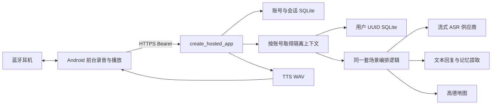
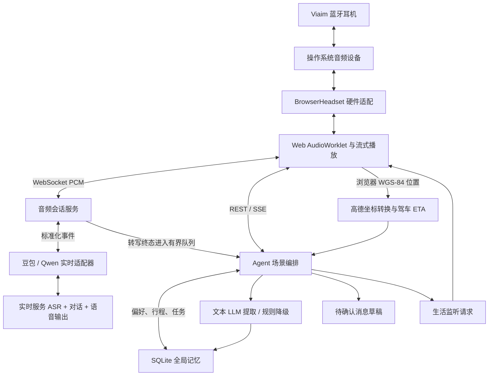
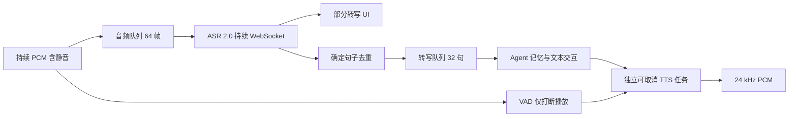
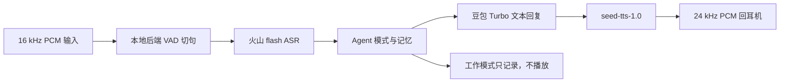
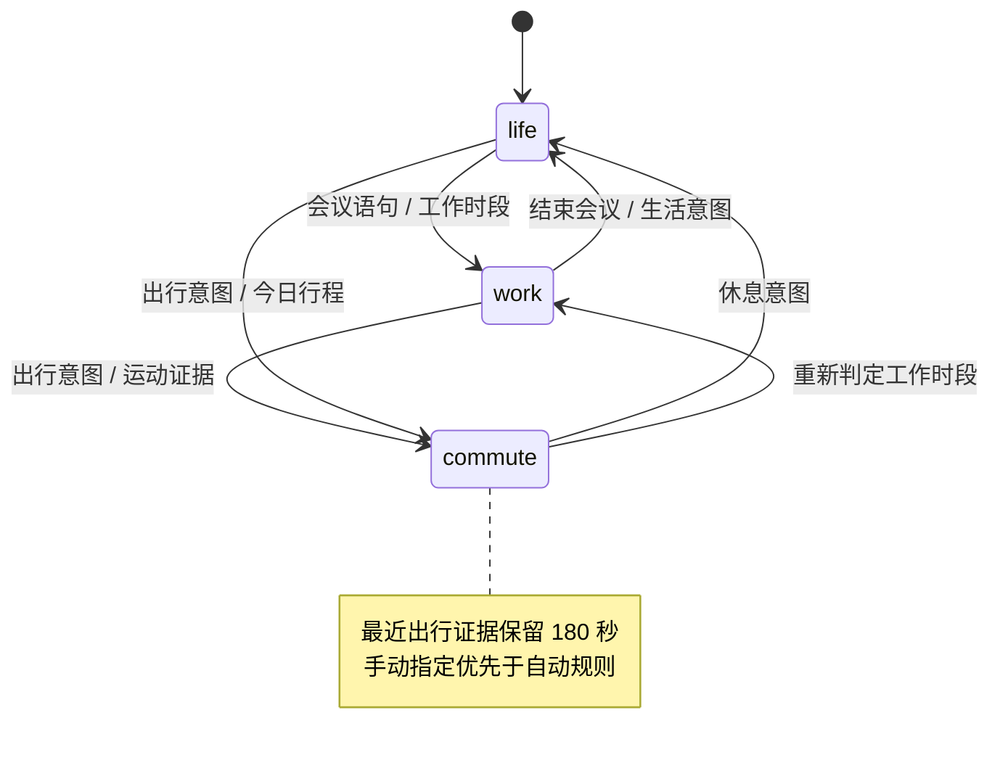
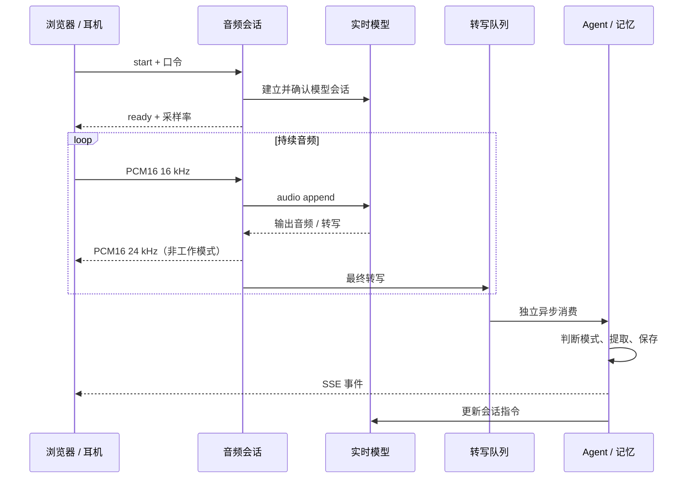

# 架构设计

## Android 多账号托管入口

当前体验链路为 `Android 原生 App → HTTPS IP 服务 → 按账号隔离的编排/SQLite → ASR、文本模型、TTS、高德`。APK 内置 `https://123.207.219.174:7776` 与限定该地址的测试 CA 信任配置；仍校验证书和主机名，不关闭 TLS 校验。用户只管理自己的用户名、密码和恢复码，供应商 Key 只在服务器。

`create_hosted_app` 只注册 `/healthz`、`/auth/*`、`/v1/*`，不挂载旧 Web、`/api/*`、SSE 或 `/ws/audio`。部署使用单进程单 worker，HTTPS 代理后端仅监听回环地址；不能直接增加 worker 绕过进程内锁。拓扑、目录和服务命令见 [部署文档](android-deployment.md)。

身份库为 `accounts.sqlite3`，存账号、密码派生值、恢复码摘要、会话摘要及限流计数。用户名只允许 3–24 位 ASCII 字母数字下划线，转为小写后唯一；密码使用随机盐 scrypt，Bearer 和恢复码只存 SHA-256 摘要。会话 30 天、最多五台登录设备；修改/恢复密码撤销旧会话，恢复密码同时换发恢复码。登录发会话前在事务中核对密码版本，防止并发重置后旧密码再次取得会话。

每个用户的业务库为 `users/<服务端 UUID>.sqlite3`，路径不使用用户名或客户端提供的 ID。所有数据访问都先鉴权，再由服务端身份选择库；提交别人的记忆、任务或草稿 ID 只会在自己的库查找并返回 404。每账号一个操作锁；冲突操作返回 409，不让清空与语音写入互相覆盖。全服务最多八个活动业务操作，运行时缓存最多 128 个账号上下文，可淘汰闲置上下文；持久数据不随淘汰丢失。

手机在前台按用户操作采集最多 60 秒 16 kHz 单声道 PCM16，结束后一次上传。后端再向 ASR 供应商流式提交，因此**不是手机到服务器的连续双工对话**。识别文本复用 `Agent.ingest` 的模式、记忆和回复逻辑；最近 12 条转写作为有限上下文。工作模式返回记录结果且 `speak=false`；其他模式独立请求 TTS WAV，再由 Android 24 kHz PCM 播放器播放。原始录音只进入有界内存，不写入账号数据库；文本、抽取记忆及幂等响应按业务规则存储。

Android 前台控制器提供手动、连续轮次、生活定时三种采集方式。后两者必须本次主动开启且页面保持前台；连续轮次在上轮处理与播放完成后再开麦，定时按设定间隔重新开始，单次时长 5–60 秒。停止、离开页面/后台、退出账号或处理失败取消调度。非工作模式的自动收尾按音量阈值检测语音：累计至少 0.2 秒语音、总录音至少 0.7 秒且后续静音达到 1.2 秒时结束本轮；它是分段 VAD，不是上游实时打断。工作记录避免用这种静音门限切断会议。服务端不运行托管录音调度器。

Android 播放使用 `AudioTrack.MODE_STREAM`：取得焦点，先静音验证真实蓝牙媒体路由，再写入语音，监听取消和路由变化。录音先释放 SCO 通信路由，再等待媒体输出恢复。实际拾音、人耳听到回复、断连及不同耳机兼容性仍需物理测试；供应商返回音频字节不能作为听音成功证据。

聊天/录音的 `request_id` 和内容指纹在用户库内留存。已完成的相同请求重试返回原结果，不重复模型调用、数据写入或额度扣减；相同 ID 内容不同或上次请求未完成返回 409。服务提供每日窗口额度、鉴权尝试限流、真实请求体长度限制，具体口径见 [API](api.md)。

Android 迁移了工作/生活/通勤、记忆来源、纪要任务、地图、消息草稿与前台定时采集；前台之外不定时开麦、不接硬件 ANC 或按键控制。旧原生实时供应商通道、浏览器 SSE、Web 调度实现继续留在下方本地入口中。开发多智能体与运行时业务是两件事：各账号隔离同一套编排服务，不是多个自主 Agent 协商。

## 保留的本地 Web 架构

把音频来回流动与业务状态、记忆处理分开。原生实时通道的音频无需等待完整文本清洗；分段通道在句子识别后完成业务处理再合成回复。模式策略、持久化、供应商协议、耳机控制各有边界。当前采用单进程模块化服务，降低 24 小时比赛中的运行成本。

以下是保留的本地开发拓扑：Viaim → 自己电脑的浏览器 → 同机 `127.0.0.1:8000` Python 服务 → 自己的 SQLite。仅模型和地图请求访问外部 API。队友通过 Git `main` 同步代码，各自 `.env`、数据库与麦克风会话独立。

## 两条主线

### 音频主线

1. 用户选择已配对的 Viaim 输入/输出并允许麦克风访问。
2. AudioWorklet 将输入重采样为单声道 16 kHz PCM16，经 WebSocket 二进制帧送后端。
3. `serve_audio()` 管理认证、供应商连接、持续收发、会话截止与资源关闭。
4. 适配器把供应商 JSON / Base64 事件归一为转写、音频、打断、指标。
5. 返回的单声道 24 kHz PCM16 在浏览器排程播放。本地 VAD 停止排队音频，上游 VAD 负责回合切分。
6. 工作模式在后端与前端都阻止助手音频播放；这不代表上游完全不生成音频，也不代表无相应计费。

### 业务主线

1. 最终转写进入有界队列，独立消费者按顺序调用 `Agent.ingest()`。
2. 根据设置、当前输入、近期运动、时区和记忆决定模式，并记录理由。
3. 可选保存原始转写，提取有效记忆，按模式执行提醒或建议。
4. 写入 SQLite，通过 SSE 通知界面；更新模型会话指令，使后续对话带上新记忆。

「双线并行」使用 `asyncio` 协程和队列，不是两条操作系统线程。实时模型承担语音理解和回答，另一个文本模型承担记忆清洗；缺少文本 Key 时继续规则提取。

独立火山路径由 `providers/volc_speech.py` 实现 flash HTTP ASR、v3 二进制流式 ASR/TTS。默认 `SPEECH_ASR_MODE=stream` 使用 ASR 2.0：资源 `volc.seedasr.sauc.duration`，端点 `wss://openspeech.bytedance.com/api/v3/sauc/bigmodel_async`。原有凭证已真实验证，不需要因为旧资源配置错误购买新权限。[官方协议说明](https://docs.volcengine.com/docs/DoubaoVoice/LargemodelstreamingautomaticspeechrecognitionAPI?lang=zh)。

### 默认连续语音通道

`provider=cascade` 且 `SPEECH_ASR_MODE=stream` 分派至 `services/streaming_cascade.py`。每个 PCM 帧（含静音）立即进入音频队列持续上传 ASR；本地 VAD 只用于打断播放，不截断、不缓存等待一句话再识别。供应商部分结果展示为 `transcript.delta`，确定句子按时间戳去重后进入记忆队列；没有句子元数据时只在最终结果做保守回退。

识别、记忆、播放使用不同协程；TTS 回复失败不会停止转写和记忆。工作模式跳过回复播放。明确 stop/时限到达时发送 ASR 结束帧，最多等待识别尾部 10 秒，再最多等待记忆队列 10 秒；客户端意外断连立即清理。音频队列满或转写积压会明确报错停止，不无限缓存。缺少 TTS 时仍可返回文字。

### 可选 flash 分段备用

设置 `provider=cascade`、`SPEECH_ASR_MODE=flash` 选择备用 `services/cascade.py`。后端按音频样本数量计时，保留 300 ms 前置音频，连续 800 ms 静音或最长 15 秒形成一句；待处理句子队列最多 4 条。新发言触发打断，旧回复不应继续播放；停止时给最后一句记忆处理最多 20 秒。原始 PCM 只在有界内存缓冲中，不写文件。

flash 备用需先等切句完成，再执行 ASR、文本交互与 TTS，其延迟不能代表默认连续 stream 通道。两种组合都不等同于原生实时模型；Qwen 原生实时保留。未配置文本模型可规则处理，未配置 TTS 仅返回转写和文字。

## 层间职责

| 层 | 入口 | 应承担 | 不应承担 |
| --- | --- | --- | --- |
| 设备 | `web/audio/hardware.js` | 设备列表、采集、输出、未来 SDK 控制 | Agent 决策、供应商 Key |
| 浏览器音频 | `web/audio/session.js`、`pcm-worklet.js` | 重采样、传输、播放、打断、释放 | 业务记忆持久化 |
| UI | `web/app.js` | 设置、授权、导出、状态与事件 | 带密钥直连供应商 |
| API | `app/main.py`、`domain.py` | 认证、校验、协议与生命周期 | 硬件 SDK 细节 |
| 编排 | `services/agent.py` | 模式、规则、调度、草稿 | 音频编解码 |
| 音频会话 | `services/audio.py` | 并发收发、积压、备用、清理 | 供应商事件泄漏到 UI |
| 集成 | `providers/realtime.py`、`services/maps.py` | 协议、超时、归一化 | 决定给联系人发送消息 |
| 记忆 | `services/memory.py`、`storage.py` | 提取、分类、去重、持久化 | 将历史文本当作系统指令 |

## 模式决策

`Agent.decide()` 是可解释规则策略，并非每次调用大模型。大模型用于实时对话与可选记忆提取，这样可降低切换延迟并便于现场排错。

判定顺序：手动模式 → 明确会议词 → 通勤词 → 生活词 → 最近三分钟运动证据 → 有输入时延续模式 → 时区、工作时段与今日行程。速度大于 `2.5 m/s` 且定位精度小于 `200 m` 可更新运动证据。该启发式不能可靠区分步行、地铁、汽车。

`decide()` 在服务启动、设置保存、文本和位置更新时调用；调度器另每 60 秒检查一次，仅在无录音会话时重新判定，支持静置跨工作时段。明确会议意图保留 30 分钟、生活意图保留 10 分钟，避免定时检查立刻覆盖；手动模式仍优先。明确会议/生活输入会清除旧运动证据。

## 三种模式

**工作：** 可选保存原始转写，文本模型提取 `fact/task/preference/trip`，无模型或失败时规则降级；不播放助手回答。实时输入为麦克风混音流，说话人暂标记「现场发言（未分离声纹）」。

**通勤：** 浏览器提供 WGS-84，高德转换至 GCJ-02 后按 `transport` 请求驾车、步行或公交规划。后台路线请求至少间隔 30 秒，浏览器位置上报至少间隔 10 秒。ETA 低于阈值或文字中出现到站/延误相关词则生成草稿，300 秒内避免重复通知。播报只提供提醒证据，尚未确认具体列车、站台和目的站匹配；公交规划也不等于车辆实时到站。

**生活：** 服务端发出 `life.listen_requested`，前端检查本次页面授权、可见性和录音状态后开启限时会话。默认每 300 秒请求 30 秒监听。普通文字调用 `ConversationService`，与记忆提取并发执行，均使用配置的豆包文本模型并关闭思考；失败时规则模板降级。语音由实时模型自然回复并读取最近记忆。VAD 是语音活动检测，不是「小聆」专用唤醒词。

高德适配层另提供目的地搜索、周边 3 km POI、adcode 实况天气，以及步行/公共交通规划扩展。主业务应显式调用这些能力，不能仅因为适配器存在就宣称生活建议已自动查询商家。公交规划标记为计划数据，POI 不证明营业状态。

## 并发与失败隔离

- 供应商备用只在建立会话时切换。中途断开需重新开始，不悄悄重放未知状态的音频。
- 转写队列容量 64；满时提示积压并停止会话。浏览器上传缓存超过 128000 字节停止采集。
- 上述 64 条是原生实时转写队列；分段语音通道的音频句子队列容量为 4，避免 ASR/TTS 调用积压。
- 默认连续 cascade 使用 64 帧音频队列和 32 句最终转写队列；ASR 不等待记忆或 TTS 完成。
- SSE 每个订阅队列容量 128，慢客户端丢弃最旧事件；重连应重新取 `/api/state`，SSE 不是可靠消息队列。
- 语音会话最长一小时。结束时尝试等待记忆队列处理，最长 20 秒，随后释放任务和连接。
- 浏览器正常停止立即释放麦克风和播放，发送 stop 后最多等待连接收尾 25 秒；快速重启等待旧连接。断网或关页不保证最后一句入库。
- `session_to_first_audio_ms` 包含连接与等待发言，不能直接当作模型推理首包延迟。

## 数据与运行边界

SQLite WAL 保存设置、记忆、转写、事件、草稿、纪要、行动项和去重标识，每事务创建连接。记忆增加 `pinned/updated_at`，已有数据库通过检查列名后迁移，不需要删除旧库。这是 Demo 规模的同步 SQLite，不是高并发数据库方案。原始音频不在本应用落盘；实时供应商接收音频，文本模型接收转写片段，高德接收坐标。第三方留存策略依所用服务条款。

这是共享单用户资料，没有租户隔离。`retain_transcripts=false` 关闭原始转写持久化，不关闭记忆提取；没有原始工作转写时无法据此生成纪要。清空数据保留设置，同步清空纪要与行动项；v2 导出包含设置、记忆、转写、草稿、纪要和行动项。访问口令不放在 URL 查询参数中。

## 记忆工作空间

`services/insights.py` 根据有界工作转写生成待核对纪要，校验决策和行动项的来源 ID、负责人及截止时间依据；失败退回规则摘录。`main.py` 按请求时段选取最近最多 80 条工作转写、串行处理纪要请求；`storage.py` 在同一事务保存报告与行动项，并以转写快照签名复用相同结果。该签名避免同一快照重复生成任务，不解决不同快照间的语义重复，也不识别独立会议边界。

`services/recall.py` 从记忆、转写和规范化行动项中做有界关键词/意图检索，再让现有文本模型筛选原文；服务端检查引用存在和摘录为连续子串。没有依据就返回不足提示。待办的 `open/done` 仅来自用户更新的行动项表；旧的 `kind=task` 记忆只是线索，不能自动判定是否完成。

`web/memory.js` 管理纪要、行动项勾选、带引用的问记忆、重要收藏、日期分组和内容更正；`web/app.js` 仍负责总体状态、设备和语音生命周期。「记住这句」在后端读取指定转写完整原文，以 `transcript:{id}` 或 `demo_transcript:{id}` 保留精确来源，并按来源幂等保存。更正笔记不修改原始转写，收藏不改变事实置信度。

纪要和问记忆复用已有 `TEXT_*` 配置，不增加独立模型、向量库或第三方记忆服务。持久化数据始终属于当前电脑；没有跨队友数据同步。具体操作与限制见 [记忆功能使用说明](memory-features.md)，产品调研是设计依据，不代表接入了硅基记忆服务。

## 扩展次序

1. Viaim SDK 到位后完成真实握手、能力探测，保留浏览器适配器。
2. 接入唤醒词/按键与原生后台能力，再实现全天候监听。
3. 新增真实公交/地铁数据源和交通方式识别，不以驾车 ETA 替代。
4. 消息渠道增加明确确认、幂等发送、回执与失败处理。
5. 多用户先引入用户/设备/会话 ID、独立记忆和鉴权，再引入任务队列与 PostgreSQL。
6. 业务层多 Agent 可拆为场景、记忆、行程、回复能力，由唯一编排者决定播放与发送等副作用。当前是单编排 Agent 与独立服务，并未实现自治多 Agent 系统；开发过程的多智能体协同不等同于产品运行时多 Agent。
