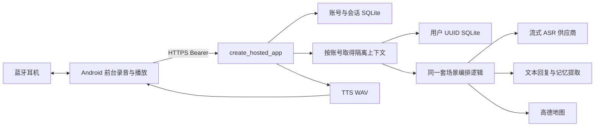

# 三模块架构

项目只有三个产品模块：`android-app/` 原生客户端、`app/` 多账号后端、`website/` 静态官网。它们共享一个仓库；`tests/`、`scripts/`、`deploy/`、`docs/` 提供测试、开发、发布和交接支持。

2026-10-17 增量：同一 `Agent` 通过 `MemoryInteraction` 路由显式记忆命令，并共享 `RecallService` 的原文证据校验。`Store.recall_records` 使用各账号库内的 FTS5 索引覆盖全部历史，按状态/记录时间过滤后截取候选；SQL触发器与内容更新同事务，首次启动回填。部署 Python 的 SQLite 需要 FTS5；索引无外部服务，业务写入应使用 `Store.connect()`（注册索引分词函数），不从其他工具绕过存储层写库。更正/遗忘失效来源与完成结果正文，同时保留请求身份防重复执行。

Android `VoiceSessionService` 提供用户主动开启的前台通知与有期限的锁屏会话授权，绑定现有唯一 `HostedSession`，没有新增第二路麦克风或产品内多 Agent。当前仍依赖 Activity 宿主存活，销毁即停止，系统回收不恢复；这是向独立后台生命周期迁移的第一步。请求用 `interaction_source` 区分定向提问与环境记录，旧客户端省略时仍按环境记录处理。详细边界见 [API](api.md) 和 [Android交接](android-handoff.md)。

## Android 多账号托管入口

M0/M1：当前只使用安卓真机。手机经 `adb reverse tcp:8108 tcp:8108` 访问 Windows/macOS 电脑回环的账号后端。debug 后端 UI 只有“本地电脑服务”和“远端服务器”，音频 UI 只有“系统蓝牙兼容”和“Rise SDK 麦克风”，两者独立；本地固定 USB `127.0.0.1:8108`，远端保持 HTTPS。旧模拟器后端偏好迁移为 USB，旧模拟器输入迁移为系统蓝牙；登录仍按精确源隔离，不复制旧源凭证，`10.0.2.2:8108` 不再允许。release 仍 HTTPS/系统蓝牙。固定 SDK 6.7 的链路为 `HeadsetController → VendorCaptureSource → HostedSession → /v1/voice`，回复经 `/v1/speech → ReplyPlayer` 验证目标耳机。停止排空、取消、代次隔离与有界缓冲见 [交接契约](android-m0-m1-handoff.md)，实物结果见 [验收](acceptance.md)。

产品保留同一个 Android 原生项目，运行于安卓真机。手机发布链路为 `Android 原生 App → HTTPS IP 服务 → 按账号隔离的编排/SQLite → ASR、文本模型、TTS、高德`。release APK 内置 `https://123.207.219.174:7776` 与限定该地址的测试 CA 信任配置；仍校验证书和主机名，不关闭 TLS 校验。用户只管理自己的用户名、密码和恢复码，供应商 Key 只在后端。

电脑开发使用 `手机配对的 Rise → Android App（debug）→ USB reverse → 同机 create_hosted_app`。`start-android-backend.*` 启动电脑回环地址 `127.0.0.1:8108` 的账号服务，存储固定在 `data/android-local/`，独立于部署数据库。Windows/macOS 都使用这条真机流程。所有页面与 `/auth/*`、`/v1/*` 契约共用，账号、会话与数据按后端独立，未实现本地/远端数据同步。供应商 Key 从电脑 `.env` 读取；无需远端服务器不等于无需外部 AI 服务。

debug 包名 `com.aidol.app.debug`，可与 release 并存。全新安装默认系统蓝牙和远端服务器；用户可独立选择 Rise SDK 和本地电脑服务。会话按服务器地址分别保存，切换后端时清除界面旧数据并使用目标地址的登录状态。HTTP 仅在 debug 对 `127.0.0.1:8108` 开放，release 保留 HTTPS。模拟器已退出产品入口，历史枚举只用于迁移，旧采集源码保留但不可从会话启动。具体步骤见 [本地测试](android-local-testing.md)。

`create_hosted_app` 只注册 `/healthz`、`/auth/*`、`/v1/*`，不挂载旧 Web、`/api/*`、SSE 或 `/ws/audio`。部署使用单进程单 worker，HTTPS 代理后端仅监听回环地址；不能直接增加 worker 绕过进程内锁。拓扑、目录和服务命令见 [部署文档](android-deployment.md)。

身份库为 `accounts.sqlite3`，存账号、密码派生值、恢复码摘要、会话摘要及限流计数。用户名只允许 3–24 位 ASCII 字母数字下划线，转为小写后唯一；密码使用随机盐 scrypt，Bearer 和恢复码只存 SHA-256 摘要。会话 30 天、最多五台登录设备；修改/恢复密码撤销旧会话，恢复密码同时换发恢复码。登录发会话前在事务中核对密码版本，防止并发重置后旧密码再次取得会话。

每个用户的业务库为 `users/<服务端 UUID>.sqlite3`，路径不使用用户名或客户端提供的 ID。所有数据访问都先鉴权，再由服务端身份选择库；提交别人的记忆、任务或草稿 ID 只会在自己的库查找并返回 404。每账号一个操作锁；冲突操作返回 409，不让清空与语音写入互相覆盖。全服务最多八个活动业务操作，运行时缓存最多 128 个账号上下文，可淘汰闲置上下文；持久数据不随淘汰丢失。

Android App 在前台按用户操作采集最多 60 秒 16 kHz 单声道 PCM16，结束后一次上传。系统蓝牙与 Rise SDK 两种输入共用 `HostedSession` 的上传、识别/回复及 TTS 流程，仅设备路由与采音策略不同。后端再向 ASR 供应商流式提交，因此不是手机到服务器的连续双工对话。识别文本复用 `Agent.ingest` 的模式、记忆和回复逻辑；最近 12 条转写作为有限上下文。工作模式 `speak=false`；其他模式请求 TTS WAV，再由 Android 24 kHz PCM 播放器播放。原始录音只进入有界内存，不写入账号数据库；文本、抽取记忆及幂等响应按业务规则存储。

Android 前台控制器提供手动、连续轮次、生活定时三种采集方式。后两者必须本次主动开启且页面保持前台；连续轮次在上轮处理与播放完成后再开麦，定时按设定间隔重新开始，单次时长 5–60 秒。停止、离开页面/后台、退出账号或处理失败取消调度。非工作模式的自动收尾按音量阈值检测语音：累计至少 0.2 秒语音、总录音至少 0.7 秒且后续静音达到 1.2 秒时结束本轮；它是分段 VAD，不是上游实时打断。工作记录避免用这种静音门限切断会议。服务端不运行托管录音调度器。

系统蓝牙兼容模式核对实际蓝牙输入，不静默回落手机麦克风；录音结束释放 SCO 后再等待媒体输出。Rise SDK 使用独立融合录音输入，不同时启动 AudioRecord/SCO。播放使用 `AudioTrack.MODE_STREAM`：取得焦点，先静音验证真实耳机媒体路由，再写入语音并监听取消、路由变化；Rise 还需核对目标身份。开发诊断显示输入/输出、录音电平、请求阶段及错误，设备就绪和音频字节不能代替真实来源与听音验收。

实际拾音、人耳听到回复、断连、来电中断及不同耳机兼容性仍需物理测试。默认前台录音在离开前台时停止；本次新增的显式锁屏短语音例外见本页开头，不提供后台连续采音或系统回收后的恢复。Windows 历史连接、握手及听音结果不证明新版通过，结果按构建分别记录在验收文档。

聊天/录音的 `request_id` 和内容/交互来源指纹在用户库内留存。已完成请求重试返回原结果或记忆变更后的撤回回执，不重复模型调用、写入或扣费。ASR 阶段失败可同 ID 重试；业务阶段可能已生效的失败保持防重复保护，状态查询不占业务锁。具体恢复、额度与限流口径见 [API](api.md)。

Android 迁移了工作/生活/通勤、记忆来源、纪要任务、地图、消息草稿与前台定时采集；前台之外不定时开麦、不接硬件 ANC 或按键控制。旧浏览器客户端、单用户入口和独立供应商 Demo 已移除。开发多智能体与运行时业务是两件事：各账号隔离同一套编排服务，不是多个自主 Agent 协商。

## 模块边界

| 层 | 所有者 | 职责 |
| --- | --- | --- |
| 原生界面与音频 | `android-app/` | 用户授权、设备选择、录音状态、停止/取消、上传和实际输出验证 |
| 设备 SDK | Android `hardware/` | 唯一 SDK 生命周期、真实就绪与属性、融合录音麦克风输入 |
| HTTP / 鉴权 | `app/main.py`、`app/services/accounts.py` | 参数和长度检查、账号会话、配额与错误响应 |
| 账号业务上下文 | `app/services/mobile.py` | 服务端 UUID 选库、按账号互斥与有限对话历史 |
| 编排与记忆 | `app/services/agent.py`、`memory.py`、`conversation.py` | 模式决策、提取、回复和草稿 |
| 纪要与召回 | `app/services/insights.py`、`recall.py` | 工作记录摘要、行动项、可核对引用与证据不足判断 |
| 供应商协议 | `app/providers/` | ASR/TTS 外部协议、超时和失败处理 |
| 事务持久化 | `app/storage.py` | 账号业务 SQLite、迁移、来源与幂等结果 |
| 官网 | `website/` | 公开产品展示和 APK 下载链接 |

自动模式仍由同一编排器判断：手动选择优先；自动模式参考场景文本、最近运动、配置时区/工作时段和今日行程记忆，并保留原因。工作模式记录但不播放，通勤根据有来源的地图信息或文本事件生成草稿，生活使用短回复和记忆。联系人消息仅生成可复制/忽略的草稿，没有真实发送接口。

记忆从模型提取或规则降级获得，持久化失败不能冒充保存成功。原话笔记使用明确转写 ID 关联，更正不改写原始转写；收藏不提高内容可信度。纪要与问记忆复用当前账号数据并检查引用。业务边界和数量上限见 [API](api.md) 与 [记忆功能](memory-features.md)。

## 官网与发布

官网是独立静态资源，不承载账号登录或 App API。nginx 当前在 `6655` 提供官网，API 在 HTTPS `7776` 转发到私有 `8108`，APK 由公开下载目录提供；官网部署独立切换版本，不重建 APK、不重启业务后端。具体目录和回滚见 [官网部署](website-deployment.md)。

开发者经根目录启动器或 `python run.py` 运行同一个 `create_hosted_app`。本地 Docker Compose 也运行账号后端，宿主只开放回环 `8108`，数据库持久化在独立卷中。共享服务的 systemd/nginx、备份及证书维护见 [后端部署](android-deployment.md)。

M2 连续语音/单场会议、M3 独立后台会话与实机验收、M4 硬件扩展仍按 [产品规划](android-rise-product-plan.md) 分阶段实施；本批有限锁屏授权不等于这些阶段全部完成。
