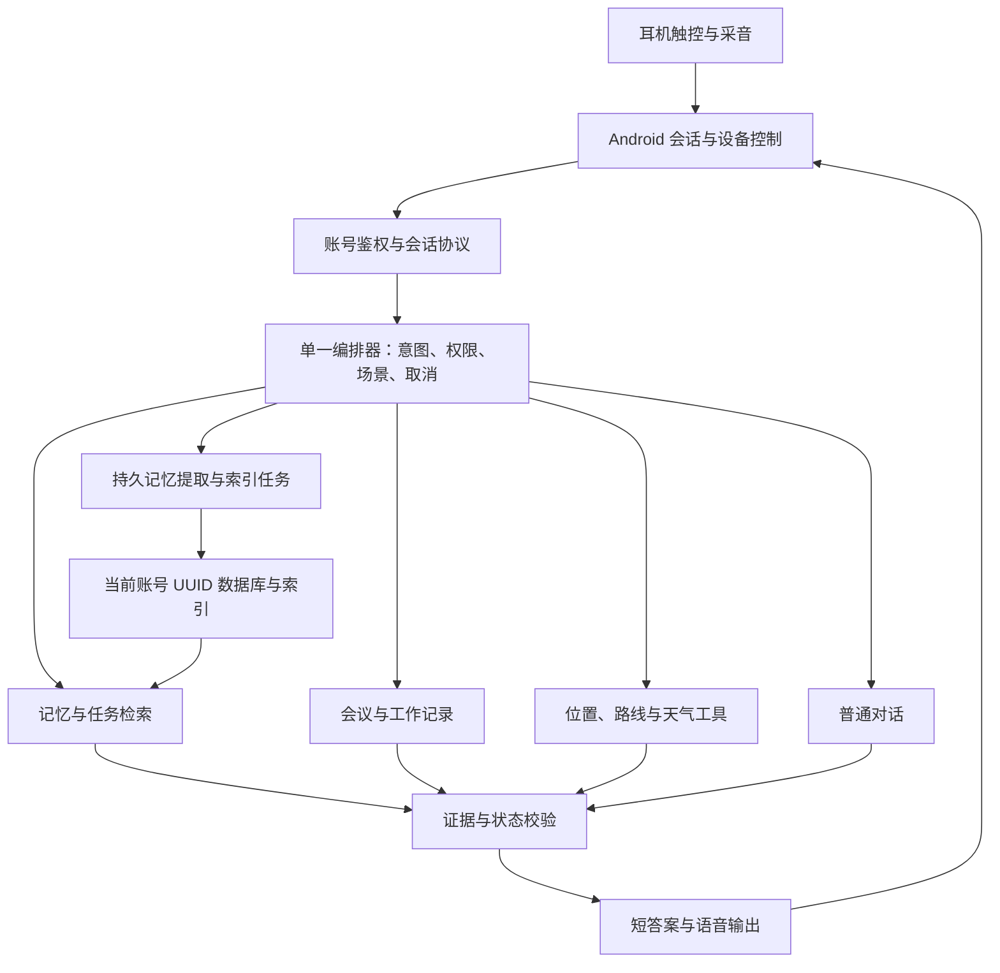

# Aidol 旗舰耳机体验：生活、工作、通勤与随时问记忆

日期：2026-10-17。

状态：产品需求与实施建议；第 1–13 节保留需求审查时的基线，第 14 节记录后续开发进展，不是全量功能完成清单。当前实现与真机结果仍以代码和 [验收记录](acceptance.md) 为准。

用户目标：打造优秀的 AI 智能耳机，围绕 **生活 → 工作 → 通勤** 持续提供帮助，并且可以 **随时问耳机，检索自己的记忆**。这里的“旗舰”是产品目标，不是已证明的行业排名。

## 1. 产品判断：同一个助手，三个场景，共享可信记忆

核心承诺应当是：**戴着耳机就能记下重要的事、找回需要的信息、完成下一步；用户知道它何时在听、记住了什么、哪些事情还没有完成。**

三种模式改变的是回应方式、记录策略和主动提醒强度，不应把用户隔成三个互不相通的聊天窗口。记忆可以跨模式访问，但必须遵守个人/工作空间、敏感程度与明确授权；进入生活模式不代表可以自动播报公司的敏感记录。

| 层次 | 解决的问题 | 设计原则 |
| --- | --- | --- |
| 场景 | 此刻在生活、工作还是通勤 | 手动选择最高优先；提及“地铁/会议”不直接等于当前场景 |
| 会话 | 此刻在待命、提问、会议记录还是播报 | 记录与提问分别标识；模式切换不等于开麦或删除记录 |
| 能力 | 记住、检索、总结、查路线、管理任务 | 三种模式均可主动调用，依据权限和当前可用数据执行 |
| 表达 | 说多少、什么时候说、是否主动说 | 生活自然简短，工作默认安静，通勤只说眼下最有用的信息 |

生活中的一句“周五下班买牛奶”，可以在工作结束后被主动查询，在用户开启的通勤会话中成为一次合适的提醒。整个过程是同一个事项的生命周期，不应重复生成三条互相独立的记忆。

成功指标优先看“无需打开手机就完成任务的比例”“重要信息找回成功率”“用户主动纠错次数”“有价值提醒占比”，再看对话轮数。长时间开麦、更多通知和更多模型调用本身不代表产品更好。

## 2. 当前基础与真实差距

以下是本轮源码检查所得，不能解释为新增实机测试。

| 能力 | 当前状态 | 对目标的影响 |
| --- | --- | --- |
| Rise 短语音 | 已有 Windows USB 开发链路真实收音、转写、耳机听到回复记录；最终手势及新版 UI 仍有待验项 | 有可继续迭代的基础，尚不能推导全部手机/固件稳定 |
| 无屏使用 | `MainActivity.onPause()` 取消会话；录音和触控依赖前台 | 锁屏、放口袋、切导航会中断核心体验 |
| 普通语音的记忆 | 上下文包含排序后的前 12 条记忆和最近 12 条转写 | 可以利用部分近期信息，不能可靠查完整个人历史 |
| 专门问记忆 | 已有 `/v1/recall` 与引用校验；目前读取有界近期集合再检索 | 应复用，但接入语音不等于完成全历史检索 |
| 工作 | 前台最长 60 秒分段；纪要按时间窗口取最多 80 条工作转写 | 不等于无缺口的单场长会议 |
| 通勤 | 地图查询、位置更新、路线估算、消息草稿 | 不等于后台导航、实时公交或可靠到站叫醒 |
| 隐私 | 账号 UUID 隔离；关闭转写仍可抽取记忆并保存幂等结果，UI 已披露 | 需要新增真实的临时会话与独立记忆授权 |
| 交付 | Rise 来源及触控主要在 debug，release 仍是系统蓝牙 | 必须把支持能力与实际安装包对应 |

值得保持的基础：SDK 单一所有者、输入输出核验、未知佩戴/电量不造假、重连不自动开麦、工作记录默认不主动朗读、引用可核对、消息草稿不冒充已发送。后续优化不得破坏这些边界。

## 3. 最高优先级：随时问耳机，检索自己的记忆

### 3.1 “随时”必须有具体含义

目标是在用户启用耳机助手会话、耳机连接且权限有效时，无需解锁手机即可触发一次提问；生活、工作、通勤不阻断记忆查询。来电、断连、权限撤销、系统回收和无网时要明确说明可用范围。

第一阶段采用真实固件验证过的触控入口和手机入口。后续唤醒词需要另行验证本地检测、误唤醒、权限、耗电和 SDK 可用性，不能把它写成现有耳机能力。停止助手后不得为了满足“随时”继续隐藏采音。

| 用户说法 | 系统应做什么 | 耳内回答示例 |
| --- | --- | --- |
| “上次我说的那家安静咖啡馆叫什么？” | 按场景、时间、地点与偏好检索；多个候选时问一次关键澄清 | “你上周六记下的是某某咖啡，提到它很安静。” |
| “我答应客户什么时候交方案？” | 找承诺及后续修改，返回当前有效期限和证据时间 | “后来改为周五下午，依据是你周二确认的记录。” |
| “刚才说要顺路买什么？” | 优先查询当前日常/出行上下文中的待办 | “牛奶和电池。目前两项都标为未完成。” |
| “上次开会，这件事怎么定的？” | 找关联会议与明确决策；区分提议和最终结论 | “最终决定先做安卓版本。我找到的是周一那场评审。” |
| “不是这次，是上个月和小王说的那次。” | 保留上轮检索对象，用人物与月份缩小范围 | 找不到时说“在已保存记录里没有找到”，不编造 |
| “这条改成周六。” | 确定指代对象、解析用户时区和日期、提交更正并返回回执 | “已将买牛奶的计划改到周六。” |
| “忘掉刚才那条。” | 确定对象与删除范围；存在歧义先澄清 | 完成删除后才说“已删除这条记忆” |

表中地点与事件均为示例，不是用户真实记忆。

回答默认采用“一个结论 + 必要的日期/来源提示”，可继续追问“谁说的”“原话是什么”“还有别的记录吗”。手机承载完整证据卡，耳机不朗读数据库编号或长篇引用。

### 3.2 不能用“多塞一些历史”替代检索

当前普通语音和专门问记忆是两条入口。首步让现有单一编排器把语音查询路由到同一召回服务，语音和页面共享权限、任务状态与证据规则。

随后从“先取最近若干条再搜索”升级为“对当前账号全部授权记录建立索引，然后按问题有界召回”。当前 `/v1/recall` 将最多 300 条任务与 500 条记忆合并，召回器又只处理该集合前 500 条，任务多时会进一步挤占记忆候选；转写也只取近期 500 条。应先解决候选范围，再讨论更大的模型。

推荐顺序：

1. 结构过滤：时间、人物、项目、地点、模式、空间、完成状态。
2. 全文检索：可先使用 SQLite 兼容的索引方案，中文分词/切片以实际测试决定。
3. 语义召回：帮助同义表达与模糊回忆；在关键词检索评估显示收益后再引入。
4. 合并与排序：兼顾相关性、明确更正、证据质量和有效时间，不能只按最近排序。
5. 有界证据回答：只使用检索出的授权证据；旧事实、猜测和已删除内容不得混成当前事实。

查询本身不应自动生成事实记忆。例如“我是不是对花生过敏？”是一项查询，不能因为含有“过敏”就成为新的健康事实。

### 3.3 记忆应有证据和生命周期

建议新增的记忆信息包括：主体、内容、原文引用、事件发生时间、记录时间、来源会话/片段、所属空间、状态、有效期、被哪条记录替代、用户确认情况。来源不可用时明确标注，不能制造原文链接。

需要区分：

- “请记住……”：用户明确保存，持久化完成后及时确认。
- 对话中的偏好或事实：按用户授权形成候选；不要每轮都机械说“已记住”。
- 他人的话、引用、假设、否定句：保留主体和语气，不能全部归到用户本人。
- “以前喜欢，现在不喜欢”：旧记录失效或被替代；保留可解释的更正关系。
- 临时事项：有截止或失效条件，不永久当作偏好。
- 待办：查询真实的任务状态；曾经承诺过不等于现在仍未完成。

工作会议原文、用户的私人提问和助手的回答要有不同来源类型。AI 输出不能再次被自动抽取为用户事实，否则会不断强化自己的错误。

### 3.4 失败、无网与隐私

没有证据、尚未同步、网络不可用、记录已删除应给出不同回答。禁止用“我不记得”掩盖网络失败，也不能把部分缓存没有结果解释为全库不存在。

离线记忆作为后续能力：用户可选择在手机加密缓存有限记录，按账号/后端隔离，带同步时间与撤销机制。但离线语音提问还依赖本地 ASR，离线朗读依赖本地 TTS；仅缓存文本不能宣称已实现离线语音问答。

临时会话分别定义不保存转写、不形成长期记忆、结果缓存的正文保留期限，以及供应商处理范围。“忘记这件事”需说明删除的是记忆、原话还是全部派生内容；删除后索引和回答缓存同步失效，后台提取任务不能复活已删内容，备份按明确保留策略处理。

## 4. 生活模式：懂得延续上下文，也懂得安静

生活模式的重点是日常事项、偏好和关系的连续性。陪伴价值来自记得准确、回应贴合、帮助兑现，而不是定时制造对话。

| 场景 | 理想闭环 | 主动性与限制 |
| --- | --- | --- |
| 随口记事 | “下班买牛奶”→明确事项→随时问回→完成或改期 | 明确要求提醒才设提醒；记忆保存不自动等于建立闹钟 |
| 个人偏好 | “最近少喝咖啡”→带有效时间的偏好→建议时适当使用→允许更正 | 不将一次选择推断为永久习惯；过敏等重要信息需核对 |
| 饮食与周末 | 偏好 + 当前需求 + 真实地点查询→给一两个可执行选择 | 营业时间、天气等需工具数据，历史喜好不能代替实时信息 |
| 生活回顾 | 用户主动问“今天有什么要记住”→汇总已记录事项→确认未完成项 | 默认不在固定时间擅自朗读隐私内容 |
| 情绪陪伴 | 用户愿意表达时倾听→询问希望倾听还是给建议→允许立即结束 | 不持续推断情绪、不装作真人、不用提醒频率推动依赖 |
| 人际细节 | 记住用户明确保存的重要日期、约定、偏好→需要时找回 | 明确这些是用户提供的记录，不虚构读取联系人/聊天记录 |

建议把当前“每隔五分钟录三十秒”从核心卖点降为实验设置：固定抽样很容易漏掉重要事件，同时制造耗电和隐私负担。更有价值的顺序是明确触发、用户开启的一段连续会话、基于已保存事项的事件提醒，再评估受控唤醒。

生活体验要求：可说“简单说”“展开讲”“今天别主动提醒”“这句别记”“刚才记错了”。这些应成为明确控制能力，而不是仅靠提示词希望模型遵守。

## 5. 工作模式：从工作片段升级为可核对的会话与行动

### 5.1 会前、会中、会后、后续四个环节

| 阶段 | 目标体验 | 必要条件 |
| --- | --- | --- |
| 会前 | “上次这个项目还有什么没定？”→检索相关决策、未完成事项和用户提供的议程 | 只用现有授权资料；日历/企业知识接入另立集成需求 |
| 会中 | 明确开始一场记录；可标记重点；查看覆盖与中断；默认不主动讲话 | 会话 ID、持续转写、片段序号、停止收尾、缺口标记 |
| 主动提问 | 用户问“刚才定了什么/上次报价是多少？”→引用证据简短回答 | 定向提问入口与会议资料分开；不能把别人一句话当用户指令 |
| 会后 | 形成摘要、决策、未决问题、行动项，逐条可回到原文 | 展示实际覆盖时间；无依据的负责人/日期保持未知 |
| 后续 | 确认任务→更正/完成→下次开会自动带入相关未结事项 | 稳定任务 ID、状态持久化、报告版本关联、提醒需授权 |

会议不能只靠“过去 24 小时”来定义。应有明确开始/结束、标题、项目归属、片段与中断历史。30 分钟、两小时及跨天会议分别评估；摘要超出模型窗口时采用可追溯分段归纳，不静默截断后宣称总结了整场。

### 5.2 “默认安静”与“问了要回答”分开

当前工作模式统一 `speak=false` 且不生成普通模型回答，不满足用户主动问记忆的目标。新规则建议：

- 被动记录：不主动回答参会者，不播报提取到的每条信息。
- 用户显式发起私人查询：允许向已核验的目标耳机短答；详细材料留手机。
- 会议内容中的命令：视为记录资料，不能启动删除、分享、发送或切模式。
- 主动会议提示：默认关闭；只在用户预先开启的明确类型/时机触发，避免不停插话。

会议中提问要复用唯一采音管线，不再开第二个麦克风。理想能力是持续记录与私人问答共存；但当前录放互斥，必须先实测播放泄漏、回声、SDK并发和焦点。未通过前可返回文字，或由用户明确选择暂停记录后听答案，标记实际缺口，不能声称无损边录边问。

### 5.3 明确采集能力，不把近讲耳机当会议室阵列

本人佩戴说话、近距离一对一、安静小会议、远处多人、重叠发言应分别验收。耳机麦克风听清自己，并不证明能完整录下会议室其他人。未验证时优先定位为个人工作记录和近距离场景。

如果目标包括多人会议高覆盖，应另行评估经验证的会议采集来源；盒子录音或其他输入只有实际支持后才能加入。说话人分离与实名归属是不同能力，不能凭模型猜名字。系统电话、第三方会议音频也不能因为 SDK 有扬声器通道就默认纳入产品。

### 5.4 行动项必须能执行和修正

区分“建议”“讨论中的方案”“已经决定”“明确承诺”。期限同时保留原话与解析结果，相对日期用事件发生时间和用户时区解释，存在歧义先确认。

再次生成纪要应更新同一任务，不能把已完成事项重新变成待办。对于外部任务系统、邮件或消息，先给出可审核内容、目标与发送状态，再按明确授权执行；未接入时继续只提供草稿。

## 6. 通勤模式：在正确时刻给出可靠的一句话

通勤的价值是减少看手机和错过关键节点。出行查询、路线进度和到站提醒应分开定义，不把一个地图页面包装成后台导航。

| 阶段/方式 | 应提供的帮助 | 不应做的推断 |
| --- | --- | --- |
| 出发前 | 确认目的地/交通方式，查询有来源的天气与预计耗时，找回相关待办 | 不能把收藏地点当成本次目的地 |
| 步行 | 关键转弯或路线变化时简短提示；可随时问记忆 | 不承诺感知道路危险或代替用户观察交通 |
| 公交/地铁 | 行程和目的站明确后，根据实际可用证据提示换乘/接近目的地 | 计划时刻不是实时到站；听到站名不是位置证明 |
| 驾驶 | 更少、更短的非必要播报，复杂答案延后，减少多轮确认 | 不能仅凭移动速度判定用户是司机而非乘客 |
| 到达后 | 用户确认或可靠行程证据结束本次出行，合并必要待办 | 不能仅由一句“到了”或旧位置默默结束其他任务 |

一次通勤应有行程 ID、目的地、交通方式、开始/结束、路线更新时间和定位精度。地下定位失效时降低确定性，明确“暂时无法确认站点”；可靠到站叫醒依赖具体数据源与实测，不能承诺必达。

主动提醒的条件应同时包含：用户已授权此类提醒、与当前行程相关、证据足够新、存在可行动价值、当前音频允许打断、同一事项未重复提醒。音乐、电话、私人答案、路线关键提示各有优先级，普通闲聊不能抢占正在进行的通话。

到站/延误词只能作为核对线索。“上周差点坐过站”不应触发当前到站提醒。旧路线 ETA 必须重新获取或标明“之前估算”；消息草稿显示依据时间，用户没有确认时不发给联系人。

示例闭环：“我今晚要顺路买什么？”→查到牛奶→用户要求“接近超市时提醒”→核对目标地点并建立本次授权→有有效位置证据时提醒一次→用户说“买好了”→更新同一任务。没有位置或提醒服务时，要明确仅保存了待办。

## 7. 耳机交互：动作少，状态明确，失败可恢复

保留现有用户指定映射：单击开始/结束发送，双击生活→工作→通勤，长按取消，三击不绑定。本文不直接修改这些行为；在不同会话状态中的语义应写成可测试的表。

| 状态 | 目标规则 |
| --- | --- |
| 待命 | 单击进入一次提问；唯一“可以说话”提示必须与实际收音就绪一致 |
| 正在提问 | 单击结束并发送；长按取消未提交输入 |
| 正在处理 | 给出短等待反馈；长按取消本轮，但不能声称撤销已保存结果 |
| 正在播报 | 长按停止本轮；其他打断方式需明确设计，不能擅改已有单击映射 |
| 正在持续记录会议 | 明确区分会议会话与短提问轮次；单击提问不自动结束整场会议 |
| 来电、断连、摘下 | 按明确规则暂停/停止；恢复只回到就绪，不偷偷继续开麦 |

录音中双击目前会丢弃未发送片段。建议后续采用“下一轮生效”的模式切换：本段仍归旧模式，用户单击发送或长按取消后才落实新模式，提示“下一轮工作模式”。不能悄悄把切模式改成自动发送，也不能在切换请求失败后把旧录音归到新模式。

本地反馈需要覆盖“已就绪、已发送待处理、已保存、未保存、已取消、需要重连”，而不只是成功路径。耳机不可用时采用手机通知/振动；不向手机扬声器外放私人答案。

现有每段提示约 1.5–1.7 秒，开始还需手势判定与 200ms 尾声等待。建议保留用户要求的简短语音，提供可选的熟练模式短耳标；任何新默认需单独决定。不要先说“开始录音”然后让用户的首字落在尚未开麦的空隙。调整提示顺序时继续隔离提示音与采集，直到回声控制经过验证。

音乐播放、原生手势、通话和 App 手势需联合验收：SDK 测试事件监听不一定消费固件原动作，可能一边启动助手一边暂停音乐。多蓝牙设备场景必须确认采集和播报指向同一授权目标，不能只检查“设备类型是蓝牙”。

持续会议引入后，结束会议和取消一次私人提问必须分别有明确、随时可用的停止入口。不能让用户以为已经全停，后台仍继续采音；具体长按语义需在实现前写成状态表和听觉反馈，并验证首次使用者能正确理解。

语音质量需要单独成为产品指标：

- 识别集包含安静近讲、街道风噪、地铁、不同口音、轻声说话和专有名词；数字、金额、人名、否定词与日期的错误单独统计，不能只看总体文字错误率。
- 私人词汇可用已授权的联系人/项目名称改善识别，但不把整份私人库无限发送给供应商。关键实体不确定时用一次简短澄清，不能自动填上最常见的名字。
- 语音回答按短句组织；链接、Markdown、长表格与编号转为适合听的表达。金额、时间与单位应读得明确，用户可调整语速、回答长度和音色；口音与语言支持以实际测试为准。
- VAD 应能处理用户思考时的停顿、低声和噪声，普通用户不需要调 RMS 数值。对话结束判断可结合静音与语义，但不能让用户为了结束一句话等待很久。
- 播放音量尊重系统设置，焦点恢复与音乐共存要可预测；不靠提高音量掩盖识别或路由问题。低电和异常提示也要可分辨、不过度重复。

## 8. 主动智能的边界

主动性按“默认按需 → 用户开启某类提醒 → 特定会话内主动辅助”逐级增加。位置、时间、记忆只是证据，不自动等于开麦、存储敏感信息或对外操作的许可。

建议统一使用以下决策：

`是否提醒 = 用户授权 × 相关性 × 数据新鲜度 × 可行动性 × 当前可打扰程度`。

这是一组产品门槛，不是伪精确的模型概率。任一门槛不足，选择推迟、放入手机摘要或询问；不要为了显得聪明频繁打断。

手动模式高于自动建议；当前明确会话高于零散关键词；历史引用、否定句和他人发言不能强制切模式。工作中问“昨天地铁上说的那件事”仍可保持工作场景。

用户应能单独控制工作消息、生活提醒、路线提示和闲聊主动性；“今天安静一点”应修改当前会话/当天的明确偏好，并能撤销，不是永久关闭所有能力。

## 9. 架构建议：一个编排器，清晰工具与持久任务

本轮使用多个开发智能体审查，不意味着产品内部增加多个自主 Agent。继续遵守现有 Android/后端/官网三模块与单一编排器边界。

职责建议：

- Android 硬件层继续唯一持有 SDK；会话生命周期逐步迁到用户显式开启的前台服务，UI 订阅状态。
- 后端服务层负责意图分派、权限、检索和工具编排；路由层只做验证、鉴权与生命周期接线，供应商协议不进 UI。
- 工具结果携带来源、生成时间、可用性、失败类别；模型不能凭一句“已完成”替代真实事务回执。
- 快速回复与记忆提取解耦；提取使用持久任务/可恢复状态，不能简单启动无人管理的后台协程。
- 长会话不占用整账号锁；状态读取、停止、记忆查询必须可以及时执行。清空/注销通过代次与删除标记阻止旧任务回写。
- 请求有 `pending/processing/completed/failed/cancelled` 等可查询状态和阶段结果；恢复使用同一请求身份，不盲目重复上传或执行工具。
- 实时协议继续在 `/auth/*`、`/v1/*` 账号体系内设计；本文不直接确定新的公开路由或迁移契约，实施时同步 API 与交接文档。

延迟优化顺序：先缩短无效提示等待、避免记忆提取阻塞答复；再实时上传和流式识别；再按句输出 TTS；最后在硬件实测支持下做自然插话与录放并发。流式方案仍要处理尾句、乱序、去重、取消、背压与重连，不能恢复已删除的旧浏览器链路。

## 10. 先修的基础问题

这些是静态审查发现或设计风险，尚未在本轮修复；具体硬件表现需新增验证。

| 项目 | 依据 | 建议验证/修正 |
| --- | --- | --- |
| SDK 和会话录音计时起点不同 | `VendorCaptureSource` 从 start 计 60 秒；`HostedSession` 从 recording 后计 57 秒再停 | 启动延迟 0/1/5/11 秒与停止延迟组合；统一截止时间，避免慢启动导致整段丢弃 |
| 佩戴历史被未知快照覆盖 | `HeadsetInteractionPolicy.device()` 只看紧邻 previous | “佩戴→未知→双耳摘下”应正确停；按当前连接保存已佩戴事实 |
| 蓝牙兼容模式缺少完整目标身份约束 | 输入选第一个蓝牙设备，兼容播放主要核验蓝牙类型 | 双耳机/车机抢路由测试；同一轮输入输出绑定目标 |
| 失败请求卡在 NULL 幂等记录 | `mobile_turn` 已 reserve，ASR 失败未完成；同 ID 继续 409 | 增加失败/处理中状态和恢复查询；保留重复副作用保护 |
| 自动记忆没有完整原文关联 | `MemoryService.extract()` 主要保存 llm/rules 来源标签 | 绑定转写 ID/证据片段；保留无转写场景的明确语义 |
| 关闭转写仍保存其他正文 | 记忆提取与完整幂等结果仍可持久化 | 分开控制转写、记忆、缓存与音频策略 |
| 旧路线用于新草稿 | 到站草稿仅核验 route.available | 检查路线年龄与位置精度；过期先刷新或明确旧估算 |

无需为写这份方案运行付费探针或实际用户录音。实现每项修复时再补有意义的回归用例和设备验收，不将本表视为“已经解决”。

## 11. 分阶段交付：以可体验的结果设门槛

优先级是新目标下的建议，保留原 M0–M4 的技术依赖；把主动开启后的锁屏能力前移，不等全双工完成后才让用户放下手机。

| 阶段 | 用户实际得到什么 | 进入下一阶段的门槛 |
| --- | --- | --- |
| A 可靠短语音与语音问记忆 | 触控提问、查已有记忆/任务、短答带来源、失败可解释 | 基础计时/佩戴/路由风险处理；无屏正常与失败流程可完成；历史记录范围准确披露 |
| B 口袋里的助手 | 用户主动开启后锁屏可用；随时发起短问答；全历史索引与更正/遗忘 | 前台服务、通知停止、来电/断连/回收；删除与权限隔离；跨机型测试 |
| C 可靠工作会话 | 持续转写、会议边界、来源与覆盖、稳定任务 ID | 30 分钟及更长实际记录；不串场、不静默漏段；停止/查询不被长锁阻塞 |
| D 有证据的通勤主动帮助 | 当前行程、数据新鲜度、必要时机的一次提醒 | 定位/网络失效降级、误提醒评估、持续通知与电量验证 |
| E 自然连续互动与硬件增强 | 经验证的插话、会议边录边问、可选唤醒、闪录或盒子 | 分别通过 SDK、固件、回声、耗电及用户价值验证，不以接口枚举代替结果 |

生活模式的记事、回忆、更正从 A 就开始；工作记忆可从 A 查询已有记录，长会议到 C 才承诺；通勤中的主动提问从 A 支持，可靠后台到站提醒需 D 的数据与系统条件。

首个演示闭环建议：**戴着耳机记录一个约定 → 手机锁屏后问回 → 说“改成周五” → 再问得到新答案 → 说“忘掉它” → 再检索确认不再使用。** 这个闭环需要 A+B，不能用当前前台版演示冒充已经完成。

## 12. 如何衡量是否真的更好

以下数字是建议试行目标，不是当前成绩或对外 SLA。先在固定手机/固件、已连接耳机、明确网络质量、指定模型和测试集上测基线，再决定正式门槛。

| 维度 | 建议指标/门槛 | 测量要求 |
| --- | --- | --- |
| 手势反馈 | 手势组合判定完成后，本地确认反馈 P95 ≤200ms | 另外记录物理触摸到事件、事件到可开口的时间，不能隐藏 400ms 组合等待 |
| 短记忆查询 | 说完至第一个有信息的语音，目标 P50 ≤1.5s、P95 ≤3s | 面向优化后的流式路径、已连接状态、约 5 秒短问句；“正在查询”不计答案；冷启动/弱网单列 |
| 无屏任务 | 固定正常与失败混合任务，≥95% 能无需解锁判断结果并继续 | 包括无结果、网络断开、取消、权限不足、模式切换 |
| 记忆找回 | 标注集中的可回答问题，首轮找回成功率 ≥95% | 混合近期与旧记录、同义改写、时间/人物、否定、冲突、删除、跨空间 |
| 答案可信 | 事实与所引证据一致率 ≥99%；无证据问题分别测拒答质量 | 不以拒绝所有问题换取“零幻觉”；答案正确性与检索覆盖分开统计 |
| 隐私隔离 | 发布门禁用例中跨账号/越权空间/已删除内容泄漏为 0 | 这是有限测试门槛，不是对所有未来情况的绝对保证 |
| 工作记录 | 每场展示采集与转写覆盖区间；测试中不出现未标注缺口 | 统计丢段、重复终句、说话人误归、摘要遗漏和任务重复 |
| 通勤提醒 | 相关且有用的提醒比例 ≥90%，另记误报与漏报 | 用户标注、实际路线、弱网/地下/取消行程；不能只看模型自评 |
| 能耗稳定 | 30 分钟和两小时任务分别测手机/耳机电量、温升、内存、断连 | 对照音乐、待机、SDK/系统采音，基线后再定每小时预算 |
| 成本 | 每成功语音任务、每小时会议、每千次召回的实际成本 | 分拆 ASR 秒数、TTS 字数、模型 token、地图次数，失败与重试单列 |

每个核心场景至少准备一组可重复的合成脚本：10/100/1000 条跨度记忆、相邻两场会议、长会议关键事项位于前中后、旧 ETA、模糊站名、来电、断连、锁屏、重连、数据清空。模型和提示词升级都重放评估集。

正式交付还要验证：支持机型/系统/固件清单、实际 release 能力与官网一致、APK 来源与签名、版本可追溯、低电与网络不可用状态、故障可定位。不能靠增加后端 worker 绕过现有单进程锁，扩容前需显式设计共享会话与任务协调。

## 13. 本轮分析范围与来源

本轮由主审和产品、Android 硬件、后端链路三个开发智能体分别审查并汇总。未修改应用功能、未调用真实供应商、未采集用户录音、未执行新的物理耳机验收。

本轮实际运行 `.venv/Scripts/python.exe -m pytest tests -q`：**243 passed，1 条既有 AnyIO 弃用警告，53.00 秒**。测试使用临时数据库与 mock providers；结果不证明旗舰方案已实现或当前 Android 实机通过。本轮未重建 APK。

主要实现依据：

- [现有产品规划](android-rise-product-plan.md)、[硬件边界](hardware-integration.md)、[手势规则](rise-controls.md)、[提示语顺序](android-audio-prompts.md)。
- [Android 主界面与生命周期](../android-app/app/src/main/java/com/aidol/demo/MainActivity.java)、[短语音会话](../android-app/app/src/main/java/com/aidol/demo/HostedSession.java)。
- [硬件采集](../android-app/app/src/main/java/com/aidol/demo/hardware/VendorCaptureSource.java)、[佩戴与手势策略](../android-app/app/src/main/java/com/aidol/demo/HeadsetInteractionPolicy.java)。
- [账号接口](../app/main.py)、[场景编排](../app/services/agent.py)、[普通对话](../app/services/conversation.py)、[记忆召回](../app/services/recall.py)、[记忆抽取](../app/services/memory.py)、[持久化](../app/storage.py)。

阅读历史规划和验收时以版本、构建与条目日期为准；较早段落中的“待验”与后来成功记录可能并存。新增设计应写入实施契约后再开发，不将愿景提前写成官网现有功能。

## 14. 后续开发：第一批可靠性改进（2026-10-17）

在需求审查之后，按用户授权开始多智能体并行开发、主线整合。这里记录代码层面的增量；不改写第 13 节此前 243 项测试的历史记录，也不把离线测试当作实机通过。

本批核心链路已经落到代码：

- 新版 Android 手动短语音和文字明确标记私人提问，三个模式均接入同一个记忆工具；环境工作记录保持安静，记录中的命令不执行。
- 当前账号全历史中文/英文 FTS5 索引，先做月份/任务状态过滤再有界召回；旧记录不再受最近 500 条限制。疑问、假设、助手回声不作为事实；自动抽取保留人物、否定与时间限定的原话。
- 可明确记住约定、问回、唯一指代更正与遗忘。关联原文、派生记录、检索与结果缓存按实际范围处理；手机新增记忆、新话题和不明确请求会清理旧指代，避免删错。仅普通 memory 支持口头修改；任务混合引用、纯原转写会要求澄清，不宣称已修改任务。
- 用户显式开启一次锁屏耳机会话后，用前台通知提供停止入口；最长一小时、任务移除/宿主销毁/来电/Rise 断连撤销，不自动恢复。代码仍依赖当前 Activity 宿主存活，未承诺系统回收后的独立运行。锁屏触控需要实际 Rise 监听已就绪，release 的系统蓝牙路径没有凭空增加 SDK 手势。
- 录音中双击切模式延后至本轮完成，不丢弃片段；未知佩戴快照不再掩盖后续双耳摘下；SDK 录音时限改从就绪计时，另设启动超时。
- 手机可查看回答依据和纪要覆盖，旧依据在更正/遗忘后立即清理；失败可只读查询请求状态，不自动重放未知结果。ASR 阶段失败允许后端同 ID 重试，业务阶段失败保留防重保护。

尚未完成：跨独立工作空间授权、真实临时会话、完整事项更正/完成生命周期、独立于 Activity 的后台会话持有、会议边界与缺口日志、可靠行程/到站提醒、实时录放并发和唤醒词。首次锁屏实机闭环仍需 USB 手机与目标耳机验收；本批不声称已经达到 A/B 全部门槛或完成 C–E。

工作和通勤链路先落实以下边界：

- 纪要覆盖信息分别记录可用片段数、实际使用片段数、遗漏数量、被截短的来源、首尾记录时间。即使本次所有保存片段均已使用，也明确表示无法证明连续采集或没有缺段；这还不是完整会议会话与缺口日志。
- 同一内容、负责人、期限且来源重叠的纪要任务复用原有事项，保留完成状态；不同会议中来源不重叠的同名任务仍分别保留。模型换一种措辞表达同一任务、语义更正任务期限的情况仍需后续稳定事项关联设计。
- 助手自己的转写不进入纪要；规则提取不再从跨句引号内生成佩戴者的第一人称承诺。负责人仍要求原文证据，不将通用麦克风标签识别为真人。
- 地图路线附带获取时间，供结果显示和后续时效判断使用。路线规划仍不代表车辆实时位置，已有路径估算也不等于已建立后台到站提醒。

离线验证使用临时数据库、模拟地图响应与合成文本，不读取开发者凭据、不调用付费探针。新增回归集中在 `tests/test_workflow_reliability.py`；本轮完整测试结果与 Android 构建、实机边界统一写入 [验收记录](acceptance.md)。锁屏会话、长会议缺口、工作空间权限和后台通勤提醒仍分别按阶段门槛验收。
