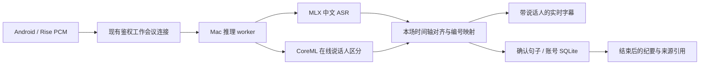

# Mac Studio 双人实时转写与说话人区分方案

日期：2026-10-18。Aidol 源码基线：`main` / `5a5ab5e`。

**交付状态：本次提交的是部署与实现方案，尚未实现或部署 Mac 模型服务，也未改变现有后端、Android、供应商选择和公网服务。** 另一台电脑可以拉取本文，完成上游模型验证后继续接入。下面的拟议接口、能力标志和工作项不能当作当前已生效的 API 或环境变量。

## 1. 已确认的需求

- 目标机器：Mac Studio，M3 Ultra；按用户提供的“512”理解为 **512GB 统一内存**，部署时核实。
- 工作模式只考虑一场 **两人对话**，先验证一场会议；先前的 5～8 人需求已撤回。
- 边录音、边转写；**第一条展示的有效转写就包含说话人标签**，不是结束后才分人。
- 首位发言者显示“说话人1”，另一位显示“说话人2”；同一个人再次开口、暂停继续及 ASR 窗口轮换后尽量保持本场编号。模型归属不确定时明确标记待确认，不能硬凑第二个人或承诺永不串人。
- 句尾允许依据原音频修正临时文字，原始识别结果与后续校订有明确来源；姓名、日期、金额和否定词是重点验收对象。
- 录音中的讲话只作工作资料，不执行其中的指令，不生成生活/通勤式语音回答；会议结束后沿用整场纪要、来源引用、行动项和回听。
- 保留 Android/Rise 的采集所有权、现有 USB 开发方式与账号隔离；没有新增浏览器客户端、手机直连模型入口或未经核验的硬件命令。

“第一条带说话人”需要先积累声音并等待识别、说话人分析都有结果，再发布该条字幕。允许短暂缓冲；实际延迟必须在这台 Mac 和目标耳机上测量，不能把模型窗口参数当作端到端成绩。两人同时讲话也不能仅靠说话人标签保证还原两份完整原话。

## 2. 拉取后的实际代码状态

本方案编写前已同步远端 `main`，以下基于 `5a5ab5e`，覆盖先前聊天中基于旧代码“工作只能结束后识别”的描述。

| 位置 | 当前实现与接入点 |
| --- | --- |
| `app/main.py` | 已有鉴权 `WS /v1/work-meetings/{meeting_id}/live?offset_ms=N`；当前按火山 ASR 配置判定实时入口是否可用。唯一业务应用工厂仍为 `create_hosted_app`。 |
| `app/services/work_live.py` | 已边接收 PCM 边调用 `speech.stream_asr(..., speakers=True)`；临时消息为 `partial {text,start_ms}`，**没有说话人字段**；最终句子保存后返回 `final {sentences:[...]}`，其中包含 `speaker`。暂停或上游累计十分钟会结束当前识别 run；代码明确说明供应商编号可能在 run 之间变化。 |
| `android-app/.../WorkLiveCaptions.java` | 已支持 PCM 上传和实时字幕；`Listener.partial(String text)` 只传文字，需要扩展后才能显示临时说话人。具体路径见下方实施清单。 |
| `app/storage.py` | 已有 `save_live_sentence`、会议句子和时间轴；`speaker_label` 只把供应商局部编号转换为展示文字，不负责整场身份关联。 |
| `HostedSession.java` / `LiveCoverage.java` | 已有持续采音、实时覆盖判断、20秒录音上传和断线后的整段识别兜底。已被字幕覆盖的片段使用 `recognize=0`，避免重复 ASR。 |
| `app/providers/qwen_meeting_asr.py` | 结束后的整场云端识别仍是另一条路径；新增本地实时服务不会自动替换它。 |

现有 `work_asr` 等能力标志、供应商配置、上传兜底、保存期限、暂停时间轴及总结契约继续以 [API](api.md)、[模式约定](mode-experience.md) 和实际代码为准。本方案尚未使“零付费语音 API”在 Aidol 中生效。

## 3. 推荐的 Mac 运行组合

| 职责 | 候选与选择依据 | 接入边界 |
| --- | --- | --- |
| 中文 ASR | Qwen3-ASR-1.7B，优先验证 FP16；社区 [mlx-qwen3-asr](https://github.com/moona3k/mlx-qwen3-asr) 提供 MLX/Metal 推理、持续 `feed_audio`、有界窗口和 `context` 词汇提示。 | 这是社区运行时，不是 Qwen 官方 Mac 生产服务；中文准确率要与当前云端及官方模型结果对照。内存充裕，先建立未压缩基线，再按测量决定量化或 0.6B。 |
| 在线说话人区分 | [FluidAudio](https://github.com/FluidInference/FluidAudio) 的 [CoreML Streaming Sortformer](https://github.com/FluidInference/FluidAudio/blob/main/Documentation/Diarization/Sortformer.md)，使用流式、有状态的低延迟配置。 | 模型有四个槽位，可用于两人场景；不能把设置人数理解为模型大小或计算量按比例缩减。不要强制把第三个异常槽位映射成已知的第二个人。 |
| 文字与人物对齐 | 同一音频样本计数、ASR 时间信息、在线人物活动时间段；必要时用 Qwen3-ForcedAligner 对已结束短句做时间对齐。 | ASR 的流式文字并不天然具有可靠逐字时间戳。跨换人点的句子需要拆分/对齐，不能按收到两路结果的先后顺序拼接。 |
| 账号与工作业务 | 现有 Python 后端和 Android App。 | Mac worker 只运行模型推理，不负责账号库、会议增删、记忆、工具或总结决策；应用中仍只有一套业务编排。 |

核对依据：

- [Qwen 官方仓库](https://github.com/QwenLM/Qwen3-ASR)：模型、上下文与对齐能力；官方 vLLM 路径不是本文 Mac MLX 路径。
- [MLX 运行时文档](https://github.com/moona3k/mlx-qwen3-asr#streaming)：`Session.init_streaming/feed_audio/finish_streaming`；同仓库 `--diarize` 是离线路径，**不支持与实时录音模式合用**，因此要另接 FluidAudio。
- [FluidAudio 包清单](https://github.com/FluidInference/FluidAudio/blob/main/Package.swift)：调研时声明 Swift tools 6.0、macOS 14；部署时以固定版本的实际清单为准。
- [Sortformer 文档](https://github.com/FluidInference/FluidAudio/blob/main/Documentation/Diarization/Sortformer.md)：流式 speaker cache、临时/确认结果、尾部排空和静态模型形状。不同版本的延迟说明存在差异，选择模型时同时核对权重目录、配置与实测。

这台机器在内存容量上有很大余量，建议先用现有硬件验证。尚无本项目 M3 Ultra 实测，不能由512GB内存推断首字延迟、同时会议数或识别准确率。模型下载和本地推理不要求购买付费语音 API Key；总结、生活/通勤、地图等现有功能仍按自身配置工作。

## 4. 同一条音频的处理流程



1. 音频维持 16kHz、单声道、PCM16；向两模型输入相同样本范围。可以把传输帧控制在约100～200ms，但模型推理窗口独立配置，不能将每帧当作独立识别请求。
2. 每场会议独立维护人物状态，状态键由已鉴权的账号与 `meeting_id` 共同确定。模型权重可共享，音频、上下文、人物缓存与输出队列不可跨账号/跨会议复用。
3. 从样本总数换算录音内毫秒，暂停期间不计时间；保持当前录音、回听、标记和文字共用一条时间轴。恢复、网络重连及 ASR 滚动窗口不能悄悄清空人物映射。
4. 临时文字与人物结果就绪后一起展示；句尾确认替换相同片段的预览，不把每次预览追加成新原文。词汇提示只放本场相关人名、项目名和产品词，不把模型猜测写成已确认事实。
5. 断线时区分“人物状态仍在”与“状态已丢失”。状态丢失要标记连续性未确认；重新识别或回滚供应商时使用独立的来源命名空间，不能把新连接的局部编号1直接当作原来的说话人1。
6. `end` 后分别排空 ASR 尾字、说话人右侧上下文和对齐任务，确认落库后才回复完成，再进入现有会议结束/总结流程。晚到结果不能恢复已删除会议、覆盖用户校订或重复生成待办。

## 5. 在 Mac 上拉取与独立验证

以下是**准备与模型验证步骤**，不是 Aidol 一键启用命令。初次需要联网下载依赖和权重；模型、音频、虚拟环境放仓库外，不把 Windows 的 `.venv` 复制过去。

### 5.1 获取本仓库

首次获取：

```sh
git clone --branch main https://github.com/joey08121112-web/Aidol-17-ling-work.git
cd Aidol-17-ling-work
git log -1 --oneline
```

已有仓库：先执行 `git status --short --branch`，保留本机改动；在 `main` 上执行 `git pull --ff-only origin main`，不使用强制重置覆盖 SDK/USB 工作。

先读根目录 `AGENTS.md`、本文与 [USB 本地开发](android-local-testing.md)。基础环境检查：

```sh
uname -m
sw_vers
sysctl -n hw.memsize
swift --version
python3.12 --version
```

应使用原生 `arm64` 的 Python 与 Swift 工具链。Python 3.12 是本方案的环境选择，需先安装；Swift 版本要满足固定版本的 FluidAudio 包清单。缺工具时先完成安装，再继续。

### 5.2 在仓库外安装上游模型工具

以下目录首次使用时应为空；已有目录先核对其来源、版本和本机改动，不覆盖。首次拉取默认分支用于调研，验收后将依赖固定为已验证的 tag/commit，并记录权重 revision、包版本和精度。

```sh
aidol_speech_root="$HOME/Library/Application Support/AidolSpeech"
mkdir -p "$aidol_speech_root"
git clone https://github.com/moona3k/mlx-qwen3-asr.git "$aidol_speech_root/mlx-qwen3-asr"
git clone https://github.com/FluidInference/FluidAudio.git "$aidol_speech_root/FluidAudio"
git -C "$aidol_speech_root/mlx-qwen3-asr" rev-parse HEAD
git -C "$aidol_speech_root/FluidAudio" rev-parse HEAD
python3.12 -m venv "$aidol_speech_root/venv-asr"
"$aidol_speech_root/venv-asr/bin/python" -m pip install "$aidol_speech_root/mlx-qwen3-asr"
"$aidol_speech_root/venv-asr/bin/mlx-qwen3-asr" --help
swift build --package-path "$aidol_speech_root/FluidAudio" -c release --product fluidaudiocli
"$aidol_speech_root/FluidAudio/.build/release/fluidaudiocli" --help
```

这些命令与入口已根据上游源码/文档核对，**未在本次 Windows 会话中执行 Mac 安装或构建**。后续不能把 `--help` 或 Swift 编译通过当成模型和耳机验收通过。

准备仓库外的两人中文测试 WAV（16kHz、单声道），使用合成语音或获准的测试语音，不调用本仓库的付费探测脚本。把下面路径替换为实际文件：

```sh
aidol_test_wav="$aidol_speech_root/test-two-speakers.wav"
"$aidol_speech_root/venv-asr/bin/mlx-qwen3-asr" "$aidol_test_wav" \
    --model Qwen/Qwen3-ASR-1.7B --language Chinese --streaming \
    --context "聆 Aidol 项目评审"
```

这是文件分块 ASR 检查，不能证明 Android/Rise 的真实持续输入、人物标签或端到端延迟。下一步需要实现接收 PCM 的 worker，将同一音频送进 `Session.feed_audio` 和 FluidAudio 的流式 `SortformerDiarizer.process`，保持同场实例，结束时排空；接口以固定版本上游源码为准。

先验证低延迟 Sortformer 配置及与其匹配的 CoreML 权重，选择 FP16 基线。不要使用没有 speaker cache、独立处理每个音频窗口的离线路径代替整场在线编号，也不要使用高延迟文件识别接口冒充实时字幕。

### 5.3 接入现有本地后端和安卓

完成第6节的代码后，再用仓库既有入口启动账号后端：

```sh
sh ./start-android-backend.sh
```

另一个终端检查授权 USB 真机并建立转发：

```sh
adb devices -l
adb -s <手机序列号> reverse tcp:8108 tcp:8108
```

后端仍为 `127.0.0.1:8108`，本机账号库为 `data/android-local/`。Android 使用同一个原生客户端和本地电脑服务，耳机仍连接手机。现阶段仅启动账号后端不会自动启用本地模型；`/healthz` 也不能代替模型健康检查。

日常托管可在验证后用 macOS `launchd` 管理推理 worker。先完成 USB 本地验收；后续如果要让公网账号后端使用 Mac 算力，再单独配置受控连接、服务认证、超时和可用性。Mac 休眠或断网时应报告推理不可用，不能显示已完整保存；不把未鉴权模型端口直接提供给手机。

## 6. 拉取后需要实现的工作

| 层 | 后续工作与完成条件 |
| --- | --- |
| Mac 模型 worker | 常驻 MLX ASR 与 Swift/CoreML 人物分析；提供启动、PCM 输入、暂停/恢复、排空、取消、健康检查；有界队列和窗口，逐场隔离状态。内部 JSONL/IPC 或回环服务二选一后固定协议；它只是推理辅助进程，不新增业务应用工厂。 |
| `app/providers/` | 新增 Mac worker 协议适配，隐藏模型细节，明确错误/超时/采样格式；不加入 UI、账号或总结规则。 |
| `app/config.py`、`app/main.py` | 增加经过实现的显式工作 ASR 选择、健康状态与能力标志；修正实时入口对云端 ASR Key 的依赖。本文未新增环境变量，不能仅填写一个自造的 `MAC_*` 字段就认为接通。 |
| `app/services/work_live.py` | 将本地 ASR、人物时间段与会议时间轴对齐；预览带人物、句尾修正、窗口轮换不重置人物；保留开始/暂停/结束、覆盖和失败语义。 |
| `app/storage.py` | 支持同场稳定人物标识和来源，按稳定句子ID/版本幂等更新；保留原始识别依据及用户校订。重试、补识别、删除和迟到回调不得重复或恢复数据。 |
| `WorkLiveCaptions.java`、`HostedSession.java`、`MainActivity.java` | 路径均在 `android-app/app/src/main/java/com/aidol/demo/`。扩展当前只传文字的临时回调与渲染，首次字幕带人物，句尾修正原位替换，分段和人物边界正确合并；保留暂停、标记、回听与尾段排空。 |
| 结束后的转写和兜底 | 决定本地选择下整段兜底和整场人物校验由谁完成；统一人物映射、来源与去重。选择本地语音时不能因结束后的旧路径偷偷调用付费 ASR；外部服务只能显式启用，并说明费用和身份连续性边界。 |
| 协议与交接 | 同步 `docs/api.md`、`docs/mode-experience.md`、Android交接与验收记录；老客户端安全忽略新字段，新客户端仅在能力和实测支持时展示相应行为。 |

**拟议的协议增量，尚未实现：** 在现有鉴权 live 连接中，临时消息增加稳定片段ID、版本、人物ID、展示名和暂定/确认状态；最终句子保留已有字段并补充同一人物ID。旧 `partial` 只有文字，旧App不会因为服务端加了字段就自动显示人物。具体字段名、存储迁移与兼容性在实施时写入 API 文档后再使用。

当前 `recognize=0/1` 覆盖和整段替换逻辑也要纳入测试，不能出现“实时文本已存但片段又识别一遍”、漏覆盖或把另一个人物来源的编号强行拼接。原始录音遵守当前账号的保存期限；不保存时也应能在有界内存中做实时分析，不能为结束后校验偷偷持久录音。

## 7. 验收与回滚

本次没有执行模型、付费供应商或物理耳机测试。以下均为另一台 Mac 的待验项，不是通过证据。

| 阶段 | 要记录的结果 |
| --- | --- |
| 环境与版本 | 芯片、统一内存、macOS、arm64 Python、Swift、上游SHA、依赖锁定、权重revision、精度和模型配置；不记录设备序列号、密钥或私人原文。 |
| 同音频准确率 | 相同两人中文音频与人工校对稿，分别比较现用云端/本地模型的字错率及人名、数字、日期、否定词错误；文字结果更通顺不能直接当作更准确。 |
| 实时人物 | 1→2→1交替、短应答、相似声线、长静默后返回、暂停恢复、ASR窗口轮换和网络重连；记录串人、编号变化、无法确定与重叠讲话情况。 |
| 首条与定稿延迟 | 从相应音频到达/发声时刻到带人物字幕显示，另测句尾定稿；记录p50/p95、测试样本数、网络和配置，区分文件处理速度与真实实时延迟。 |
| 稳定性 | 一场连续30～60分钟，观察队列、统一内存、人物状态和延迟；在单场通过前不宣称支持多场并发。 |
| 业务与隐私 | 账号/会议隔离、保存期限、原文校订、删除与迟到结果不复活、请求幂等、云端关闭时无付费语音请求、工作不执行录音中的指令。 |
| Android / Rise | USB真机真实来源、双方是否被清楚录到、首句/尾句、暂停不上传、标记时间、回听对齐、停止排空、断连/取消/切模式；编译通过不代替人耳与实机观察。 |

实现代码后的仓库验证：

```sh
python -m pytest tests -q
python -m compileall -q app
cd android-app
./gradlew testDebugUnitTest lintDebug assembleDebug
```

新增离线测试使用临时数据库、模拟模型和合成PCM；Mac模型验证单独执行，不加入自动付费探测。实际观察写入 [验收记录](acceptance.md)，注明提交与模型版本。本地方案验收前保留原供应商的显式选择与已有业务数据，不替换公网APK或默认生产路径；切回旧配置时继续使用旧路径真实可用的能力，不能继续宣称首条实时人物已就绪。

## 8. 给另一台电脑的续接说明

> 阅读根目录 AGENTS.md 和 docs/macos-two-speaker-deployment.md。目标是在 Mac Studio M3 Ultra／512GB统一内存上，为现有 Android 工作模式接入两人中文实时转写与在线说话人区分，第一条有效字幕带人物、整场尽量保持编号。先核对拉取后的 main 与上游版本，在仓库外建立 MLX ASR 和 FluidAudio/CoreML 验证环境，再按第6节接入。保留现有账号鉴权、单一业务编排、USB/Rise采集、录音时间轴、回听、校订和结束后纪要，不改生活/通勤链路，不恢复浏览器客户端，不提交模型、凭证、录音、数据库或产物。区分环境准备、模型文件检查、真实持续PCM链路与耳机验收，所有未测项如实保留。本文是方案交接，不能把依赖安装成功当作功能已经部署完成。
