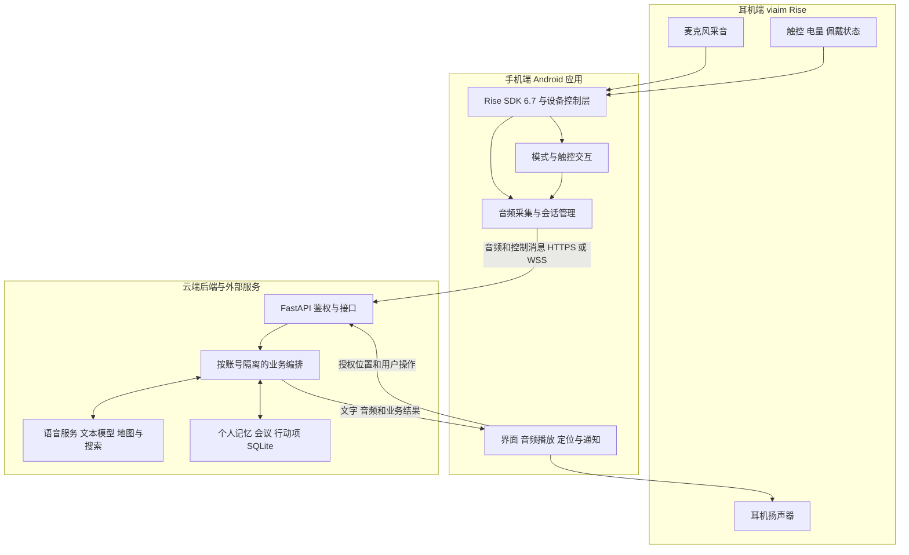

# Aidol 聆 AI 智能耳机作品技术说明

Aidol 聆是一款基于 viaim Rise AI 智能耳机二次开发的随身 AI 助手。作品将耳机、Android 应用和云端 AI 服务连接起来，让用户通过说话和耳机触控完成日常对话、工作记录、个人记忆查询和通勤辅助。开发重点是耳机 SDK 接入、音频链路与交互控制，以及面向实际场景的 AI 应用。

## 1 作品概述

### 1.1 解决的问题

日常使用手机时，查信息、记事情和整理会议往往需要反复解锁、输入或切换应用。普通耳机主要承担听音和通话，难以把听到的内容进一步整理成可查询的个人资料。

本作品以耳机作为语音入口，将听到的信息转成对话、记录和后续行动。用户可以在工作时安静记录会议，结束后查看纪要与待办；在生活中通过语音提问、保存偏好或查询曾经说过的事情；在通勤时获取路线、天气和站点提醒，减少频繁查看手机的操作。

### 1.2 作品完成的功能

| 场景 | 用户可以完成的操作 |
| --- | --- |
| 生活对话 | 通过耳机与 AI 连续交流，查询时间、天气、地点和公开网页信息，结合已保存的个人偏好获得回答 |
| 个人记忆 | 从对话中提取事实、偏好、任务和行程；手动保存、收藏、编辑、更正或删除记忆；按问题检索历史原话 |
| 工作记录 | 主动开始会议录音，查看实时字幕，暂停、继续和标记重点；结束后生成会议摘要、人物观点、决策和行动项，查看原文及回放 |
| 通勤辅助 | 保存常用地址，通过对话补齐起点、目的地和出行方式，查询路线与目的地天气，打开高德导航，接收 App 站点通知和语音提示 |
| 耳机交互 | 读取设备就绪、电量和佩戴状态；通过耳机触控开始或结束会话、切换模式、标记重点和调节媒体音量 |

### 1.3 交互流程

首次使用时，用户安装 Android 应用，注册账号并保存恢复码，在系统中配对耳机，再在应用内连接并等待 SDK 通信就绪。授予所需的蓝牙、麦克风、通知和定位权限后，选择生活、工作或通勤模式。

**生活对话：** 用户主动接通 AI 语音 → 耳机采集说话内容 → 手机上传音频 → 云端结合记忆和工具生成回答 → 手机显示文字并将语音播放到耳机。连续通话保持同一连接；AI 回答期间可通过“小万”打断后继续提问。

**工作记录：** 用户开始会议 → 耳机采音并上传 → 手机显示实时字幕 → 用户按需暂停、继续或标记重点 → 结束并保存 → 云端进行整场转写与纪要整理 → 用户查看原话、摘要和行动项，并可回放、导出或修正后重新生成。环境记录保持安静，不自动回应会议中的闲聊。

**通勤辅助：** 用户说出出行需求 → 系统追问尚缺的出发地、目的地或交通方式 → 确认地址 → 手机在取得所需权限后启动行程 → 查询路线和天气并播报 → 按用户选择打开高德导航，持续提供行程及站点提醒。

## 2 元器件清单

| 名称 | 型号规格 | 数量 | 来源（自带／现场领取／Aidol 币兑换） | 是否开赛前已有 | 在作品中的作用 |
| --- | --- | --- | --- | --- | --- |
| viaim Rise AI 智能耳机 | viaim Rise，接入官方 Rise SDK 6.7 | 2 | Aidol 币兑换 | 否 | 作为硬件二次开发平台，提供麦克风采音、语音播放、触控以及电量和佩戴状态上报 |

Android 手机用于安装应用、连接耳机和执行本地交互；电脑用于开发调试，云端服务器用于运行后端。这些属于配套运行环境，本表不另外填写未经确认的型号、数量或器件来源。

## 3 系统架构

### 3.1 从感知到处理再到执行

系统采用“耳机感知、手机控制、云端处理、手机与耳机执行”的协同架构。耳机采集声音并上报触控和设备状态；Android 应用管理采音、界面、播放及系统权限；云端完成语音理解、记忆、纪要和地图查询，再将处理结果返回手机。

| 所在位置 | 主要职责 |
| --- | --- |
| 耳机端 | 通过原厂硬件和固件采集声音、播放声音，上报 SDK 支持的设备属性和触控事件 |
| 手机端 | 维护 SDK 连接，接收 PCM 音频，控制会话与播放，展示对话和记录，执行定位、通知及导航跳转 |
| 云端后端 | 验证账号、选择用户数据、编排 AI 与工具、处理记忆和会议、持久化业务结果 |
| 外部服务 | 提供实时语音、语音识别与合成、文本生成、高德地图和博查网页搜索能力 |

### 3.2 底层 SDK 接入与硬件抽象

作品通过官方 Rise SDK 6.7 接入耳机。SDK 所有权集中在 Android 的 `hardware` 包内，设备协议与应用页面分开管理，形成以下调用链：

`Rise SDK → HeadsetController → FusionDevice → VendorCaptureSource → HostedSession`

**连接与生命周期管理。** `HeadsetController` 是 SDK 的唯一管理入口，负责初始化、连接、监听、属性读取和释放。应用区分“正在连接”“传输连接”和“通信就绪”等状态，等待 `onConnectReady` 并核对目标设备身份后，才允许启动采集。这样可以避免只看到蓝牙配对成功，就误判耳机已经能供业务使用。

**统一采集接口。** `FusionDevice` 封装设备录音与状态回调，`VendorCaptureSource` 将厂商回调转换成业务可消费的音频流。`HostedSession` 使用统一采集接口组织录音、上传和结果处理，页面无需直接调用厂商录音命令。

**真实音频接入。** 通过 SDK 的 `startFusionRecord` 启动融合录音，通过 `stopFusionRecord` 请求停止。回调中的音频按通道区分，普通环境记录只接收 channel 2 的麦克风数据，channel 1 的扬声器数据不作为环境语音送入识别。上传使用 16 kHz、单声道、PCM16 音频。

**采集状态与缓冲管理。** SDK 回调进入有界队列，由消费线程继续处理，避免网络等待阻塞设备回调。程序检查音频长度、样本完整性和队列容量；正常停止后等待设备结束并排空数据，再提交本轮。取消、断连或超时会使旧回调失效，防止已经结束的会话重新开麦，或把上一轮音频混进新一轮。

**设备状态接入。** 应用接收 SDK 返回的电量、佩戴及固件等属性，用于设备页展示和交互判断。未知值保持未知，不把未上报的数据显示为正常。设备断开、双耳摘下等事件会进入会话停止或交互拦截逻辑。

### 3.3 耳机触控与场景交互设计

SDK 事件先由设备层确认来源，再交给 `HeadsetInteractionPolicy` 根据当前模式、录音状态、佩戴状态和授权状态决定动作。同一手势可以服务不同场景：

| 交互事件 | 应用处理 |
| --- | --- |
| 单击或单捏 | 在可操作状态下开始会话，或结束并提交当前会话；具体动作随当前状态变化 |
| 双击或双捏 | 通常循环切换生活、工作和通勤模式；工作会议录音中改为标记重点 |
| 耳机柄前后滑动 | 请求系统增加或降低一档媒体音量，不改变工作录音路由 |
| Logo 区长按 | 结束当前会话；工作记录进入结束保存流程 |
| 耳机柄长捏 | 撤销待判断的组合事件，当前没有映射为 ANC 切换 |

交互层加入事件去重、去抖和组合手势等待，避免双击被提前当成两次单击。事件还绑定当前设备及会话代次，迟到事件不能作用于新会话。应用使用本地耳标提示模式和操作状态，减少用户为确认状态而查看手机的次数。

### 3.4 实时对话与音频播放

手机通过鉴权 WebSocket `/v1/voice/stream` 上传音频，云端根据能力配置选择两条路径：

**原生实时音频路径：** 耳机 PCM → 手机 WebSocket → 后端 Qwen 协议适配 → Qwen 实时音频模型 → 文字与回复音频 → 手机 → 耳机。该路径支持连续双工会话、接通前准备、字幕和回答打断。回答期间的背景声音不会仅凭音量变化反复取消回答，识别到约定的“小万”打断表达后才进入相应处理。

**级联路径：** 耳机 PCM → 火山流式 ASR → 文本模型与业务工具 → TTS → 手机 → 耳机。该路径用于独立识别、合成及相关兼容场景，与原生音频路径共享账号、记忆和业务逻辑。

回复由 Android `ReplyPlayer` 使用 `AudioTrack` 流式播放。播放前检查真实音频输出路由与目标耳机身份，避免把私人回复误放到其他设备。采集与播放由会话状态和资源占用机制协调；工作环境录音保持静默。连续双工模式采用独立的实时会话控制，不能将所有录音场景简单套用同一套录放时序。

### 3.5 AI 编排与个人记忆

后端使用 FastAPI，通过唯一应用工厂 `create_hosted_app` 提供账号和业务接口。每个活跃账号有独立的 `MobileRuntime`、`Agent` 和数据存储。对话、记忆、会议和通勤复用同一套账号上下文，运行时没有多个独立推理 Agent 相互调度。

`Agent` 区分主动提问与环境记录，再调用对话、记忆或场景服务。文字回复与记忆提取可以并行进行，最终保存回执以实际落库结果为准。模型通过受限工具查询天气、路线、地点、网页和历史记忆，工具参数由后端校验；保存、更正、遗忘等修改操作由明确的业务流程执行。

记忆分为事实、偏好、任务和行程，并尽量保留原话及转写来源。每轮回答最多注入 60 条记忆，优先选择置顶、与问题相关和近期内容；其他历史通过 SQLite FTS5 按需检索。检索回答中的引用 ID 与摘录需要校验，用户可以回看来源，更正或删除已经保存的内容。

### 3.6 工作会议与纪要处理

工作记录以独立会议对象组织。手机采音时保留音频时间轴和可靠上传序号，通过实时通道展示字幕；实时字幕不可用时，由分段识别兜底。暂停、继续和重点标记记录在同一会议时间轴上。

结束后，在工作 ASR 已配置且整场音频可用的情况下，后端组装 WAV，提交 Qwen Filetrans 整场说话人识别，得到整场范围内一致的匿名说话人编号。未取得整场结果时保留已有转写，不把局部说话人编号当成已确认的整场身份。

纪要服务一次使用整场已保存原文，生成摘要、人物观点、冲突与澄清、重要事件、决策、待确认事项和行动项。人物、时间、地点及任务信息需要对应原文依据，不能确认的字段留空。用户可查看原话、回放音频、管理行动项，也可提交修正内容后重新生成纪要。

工作采集还设计了媒体与通话场景路由：播放音乐时只保留麦克风通道；接到电话后，只有系统通话状态和 SDK 通话场景同时确认，才进入电话双方音频处理。该路由避免将音乐扬声器数据误认为参会者声音，实际效果受手机、耳机固件及通话路由影响。

### 3.7 通勤处理与执行

`CommuteDialogue` 收集起点、目的地和交通方式，缺少信息时继续追问；地址重名时要求用户确认，不让模型自行编造坐标。确认后返回结构化出行计划，由手机取得所需权限并启动行程。

后端调用高德查询驾车、步行、公交或骑行路线、地图预览和目的地天气。手机端 `CommuteService` 负责已启动行程中的定位更新、进度判断、App 通知和语音提示，并可通过 Intent 打开高德导航。GPS 与高德坐标按约定转换，定位的时间和精度也参与有效性检查。

公共交通提醒基于路线站点、计划时间和手机位置判断，不把计划路线当成车辆实时位置。到达通知使用 App 本机通知；面向联系人的内容只生成草稿，由用户自行发送。

### 3.8 数据保存与运行方式

身份信息保存在账号库中，业务数据按服务端 UUID 分别保存到 `users/<UUID>.sqlite3`。客户端登录后使用 Bearer 会话访问数据，不能通过提交别人的记录 ID 切换到其他账号的数据。

语音会话使用账号锁防止相互覆盖；地图、搜索等独立查询可以在不占用语音锁的情况下进行。请求通过请求 ID 和状态记录处理重复提交及失败恢复，迟到的处理结果在保存前检查来源，避免清空或修改后的旧数据被重新写回。

用户使用时，手机连接远端 HTTPS 服务。开发时同一套后端运行在电脑 `127.0.0.1:8108`，真机通过 USB reverse 访问；两者使用相同接口，账号和数据分别保存。供应商 API Key 只配置在后端，不放入 APK 或官网。

## 4 接线图和结构件文件

无新增接线图、原理图或 3D 打印结构件文件。本作品使用完整的 viaim Rise 耳机及原装充电盒，通过蓝牙与手机通信，开发工作在 SDK 接入和软件应用层完成，不拆改耳机内部电路或外壳。

## 5 软件和固件

### 5.1 软件仓库

项目仓库：https://github.com/joey08121112-web/Aidol-17-ling-work

仓库包含 Android 应用、云端后端、静态官网，以及测试、部署和使用文档。提交的主要软件内容如下：

| 目录 | 内容 |
| --- | --- |
| `android-app/` | Android 原生应用，含 Rise SDK 接入、设备控制、语音会话、会议、通勤和账号界面 |
| `app/providers/` | Qwen 实时音频与工作转写、火山语音、高德地图、博查搜索等协议适配 |
| `app/services/` | AI 编排、个人记忆、会议纪要、行动项及通勤业务 |
| `app/main.py` 与 `app/storage.py` | API、鉴权和生命周期入口，以及 SQLite 持久化 |
| `website/` | 作品介绍和 Android 安装包下载入口 |
| `tests/`、`scripts/`、`deploy/`、`docs/` | 自动化测试、真机开发与手动检查脚本、部署配置及技术资料 |

### 5.2 自主开发内容与原厂能力

本项目基于原厂耳机硬件、固件和官方 SDK 开发，自主完成 Android 应用、SDK 与业务之间的适配、音频会话控制、耳机交互策略、云端业务及数据管理，并接入外部 AI 和地图服务。

本次未自行编写、修改或烧录耳机固件。耳机连接、融合录音及设备事件来自官方 SDK，AI 模型推理由外部服务提供，作品负责将这些能力组合成实际可操作的应用流程。

### 5.3 运行与验证

开发环境使用 Python 3.11 及以上版本、JDK 17 和 Android SDK 35。后端通过仓库启动脚本运行，Android 工程使用 Gradle 构建，耳机 SDK 固定为 6.7 并校验版本文件。

仓库提供后端离线测试、Android 单元测试及真机交互测试。离线测试使用临时数据库和模拟供应商，避免消耗真实 API 配额；这些测试替身仅用于软件验证，不作为作品实机演示。具体构建和硬件观察记录见 `docs/acceptance.md`。

## 6 安全说明

本作品不涉及自制电池、升压电路、额外供电、高温加工、焊接或切割。耳机及充电盒保持原厂电池、供电和充电结构，使用原装或符合原厂要求的充电设备；无新增工作电压或自制发热部件。

软件使用时由用户主动开启录音，并提供停止入口。涉及会议或通话录音时，应告知并取得相关参与者同意。账号数据按用户隔离，用户可管理、导出或清空数据，供应商凭证保留在后端。

## 7 已知限制及演示真实性

### 7.1 已知限制

- AI 对话、语音识别、纪要和地图查询依赖网络及对应服务的权限、额度和可用性，目前不提供完整离线 AI 推理。
- 当前以 Android 手机和 viaim Rise 耳机为目标组合，尚未提供 iOS 客户端；不同手机系统、固件和蓝牙路由可能影响体验。
- 锁屏使用依赖用户已开启的前台会话及通知权限；应用被系统回收后不会自动恢复录音。
- 说话人编号用于区分整场中的不同声音，不代表真实姓名；转写和 AI 整理结果仍需结合原话核对。
- 通勤路线及到达时间属于估算，地下定位和路线数据变化可能影响站点提醒；没有接入公交车辆实时追踪。
- 当前不提供自动发送微信或短信、下单支付、购票等操作；ANC 和通透模式没有接入已确认的控制协议。

### 7.2 演示真实性

作品实机演示使用真实耳机、Android 应用和后端服务，所展示的功能通过真实设备和服务链路执行。没有将预置问答、静态界面或模拟供应商响应作为实机功能展示，具体操作与效果详见产品介绍及实机演示视频。

代码中的模拟服务用于自动化测试，与实机演示分开。上述功能限制仍适用，视频中未展示的设备组合和使用条件不据此视为全部验证通过。

## 8 实机演示视频和过程照片

实机演示视频及各关卡过程照片待补充。

| 材料 | 内容 | 状态 |
| --- | --- | --- |
| 产品介绍与实机演示视频 | 作品概述、耳机连接、语音对话、工作会议、个人记忆和通勤辅助的实际操作 | 待补充 |
| 器件与开发过程照片 | 兑换耳机、设备连接、SDK 接入及真机调试过程 | 待补充 |
| 各关卡过程照片 | 对应关卡中的实际操作、作品状态和完成结果 | 待补充 |
