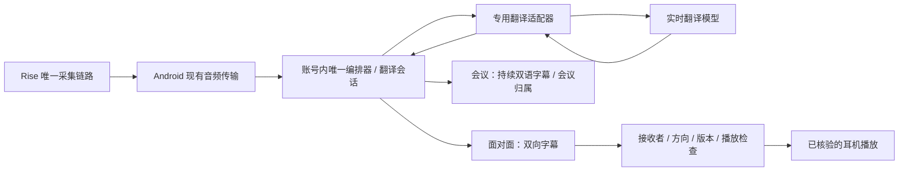

# 会议实时翻译字幕与中英面对面对话：可行性与接入方案

调研日期：2026-10-17。源码基线：`f12fd813ebceb38ae24020390e0d6ce1abf3754e`，初次检查时本地 HEAD 与远程 main 一致，工作区干净。用户确认本轮只做调研结论和接入方案，并补充确认：**会议实时翻译字幕与中英面对面对话都是首版必需能力**；其他语言可后置，若增量很小可一并纳入，但不能拖延这两项。本文是建议，不是已实现的 API 契约或翻译验收记录。

## 结论

Aidol 可以接入现成模型实现实时翻译，无需从零训练基础模型。推荐先用专用实时语音翻译 API 验证体验，优先候选为 Qwen-LiveTranslate，火山 Seed LiveInterpret 2.0 作为中英对照；保留 ASR→专用文本翻译→TTS 的可解释备用方案。开源自部署路线可行，但先作为独立性能实验，不把 GPU 推理依赖加入现有账号服务。

建议首版共用翻译核心，提供两个分别验收的入口：

| 首版必需入口 | 推荐体验 | 主要验收重点 |
| --- | --- | --- |
| 会议实时翻译字幕 | 持续采集、原文与译文对照、匿名说话人标签与手动纠正；默认安静，不播报 | 长时间连续、不漏句/重复、修订稳定、与当前会议归属一致 |
| 中英面对面对话 | 英→中和中→英两个方向；原文/译文字幕，佩戴者可听译音；反向译音先受控播放 | 双向语义、方向切换、实际听音、回声和取消 |

两项同属首版范围，开发次序可先验证字幕再增加译音；只完成其中一项不能称为首版完成。面对面首版建议明确方向切换，随后再验证自动双向。当前客户端核验耳机输出；若增加手机扬声器给对方听，必须作为独立输出功能实现、显式选择和验收，不能自动回落。

推荐区分保存策略：会议由用户明确开始记录后，按会议保存获准的原文、译文及修订；若选择仅看字幕则不归档。面对面默认仅当前会话使用，明确保存后才归档。两者均不自动提取个人长期记忆、不调用助手工具、不复刻声音。上述具体默认交互仍为建议，不是用户已确认的完整需求。

尚不能证明：现有 Key 能访问翻译模型；当前 MaaS 地址兼容官方翻译协议；Rise 可稳定拾取对面说话者；中英双向可由一个固定目标语种会话自动完成；第三人/重叠语音可可靠路由；离线或零延迟可用。

其他语言的纳入条件：已选模型支持所需方向与输出模态，只需语言配置/界面选项，且能完成小规模真实验证、无需新增供应商或显著改变会话/音频设计。字幕和译音逐语种标记支持，不能因文本可译就宣称可播。超出这些条件时后置；本轮尚未指定其他目标语言，不能据此承诺全部语言上线。

## 1. 项目现状与可复用部分

本轮阅读了 AGENTS、架构、Qwen 实时接入、验收记录和相关代码。`qwen_realtime.py` 已有实时模型 WebSocket、TLS、音频收发与事件处理；`duplex_voice.py` 已有持续输入、取消、回合与播放确认；Android 已有 Rise PCM 输入和 ReplyPlayer 输出核验。原有 ASR/TTS 可作为级联原型组件。`work_meetings.py` 与存储已有独立会议结构，不能继续按早期“无会议 ID”的快照理解项目。

当前 Qwen 持续通话不是翻译功能：

- `qwen_voice.realtime_instructions()` 要求简短中文回答，允许调用工具，结合个人记忆。
- `QwenRealtimeProvider.transcription_session()` 固定中文转写设置，需要为双语评估重新设计。
- `duplex_voice.input_events()` 在回答期间过滤普通输入，以“小万”作为打断条件；翻译不能照搬此规则，否则会漏掉连续讲话。
- 通话转写通过 `runtime.turn()` 进入记忆和业务；翻译资料不应默认进入这些写入路径。
- 当前 Qwen 上游为 `maas.qianwenaiapi.com`，官方翻译文档使用带业务空间 ID 的阿里云地址。不能仅更换模型名就宣称接入完成。

本轮执行 `.venv/bin/python -m pytest tests -q`：**463 passed，1 条 Starlette/AnyIO 弃用提示**。测试使用模拟供应商和临时数据库，证明既有回归状态，不证明翻译质量。未调用付费翻译模型、安装 APK、修改凭证、部署或测试实体耳机。

## 2. 厂商产品可借鉴的体验

| 产品 | 官方说明支持的体验 | 对 Aidol 的启示 |
| --- | --- | --- |
| Apple AirPods 实时翻译 | 选择对方与自己的语言；译音进入耳机；反向回复可通过 iPhone 展示/播放。下载语言模型后在 iPhone 本地处理 | 明确方向、接收者与开始/停止；手机近距离拾音也是产品设计的一部分。本地处理是其能力，不能归于 Aidol 云端方案 |
| Google Pixel Buds＋Google 翻译 | 耳机和手机共同参与对话，译音按操作进入耳机或手机 | 受控轮流翻译是有效的起点，不必第一版就实现自动多人路由 |
| Samsung Interpreter＋Buds | 听译模式提供屏幕转写和耳机译音；依赖兼容手机与应用 | 把持续听译与面对面对话分别设计；耳机不是独立运行全部翻译模型 |

资料：[Apple](https://support.apple.com/zh-cn/123185)、[Google](https://support.google.com/googlepixelbuds/answer/7500719?hl=zh-Hans)、[Samsung](https://www.samsung.com/us/support/answer/ANS10004610/)。这些是官方功能说明，本轮未实测上述产品。未发现可直接供 Rise Android 调用的 Apple AirPods 翻译服务；不要把 Apple 产品功能当成可复用后端。

## 3. 模型路线选择

| 路线 | 可行性与适用范围 | 接入判断 |
| --- | --- | --- |
| Qwen 专用实时翻译 | 官方提供流式音频输入、译文/译音输出；当前文档包含 qwen3.8-livetranslate-flash-realtime，中英均支持文字和音频 | 优先独立探测。可复用传输经验，不能复用普通回答语义；协议和现有网关权限另验 |
| 火山 Seed LiveInterpret 2.0 | 官方说明支持中英端到端同传 | 作为 A/B 候选；现有火山 ASR/TTS 凭证不证明同传资源已开通。部分文档页面依赖 JS，本轮信息不构成完整协议验证 |
| 现有 ASR→文本翻译→TTS | 组件可分别替换，易保留原文、术语、来源与输出控制 | 无专用模型权限时可先做；分段和三段服务会增加延迟，不能包装成无等待同传 |
| 开源自部署 | 能自行控制模型与数据流 | 先测目标服务器的实时率、显存、并发、许可和质量；不是“开源就免费或无需运维” |

Qwen 官方参考：[模型与语言/接入](https://help.aliyun.com/zh/model-studio/qwen3-5-livetranslate-flash-realtime)、[客户端事件](https://help.aliyun.com/zh/model-studio/live-translator-client-events)、[服务端事件](https://help.aliyun.com/zh/model-studio/live-translator-server-events)。火山：[产品说明](https://docs.volcengine.com/docs/DoubaoVoice/ProductOverview-3?lang=zh)、[开发参考](https://docs.volcengine.com/docs/DoubaoVoice/Developmentreference-3?lang=zh)。

Qwen3.8 文档中的 speaker_detection 可返回 speaker_id，并能用 item_id/previous_item_id 关联原文与译文。这有利于之后的参与者界面，但只是供应商匿名标签，不是实名、谈话对象或授权证明。3.5 与 3.8 会话字段不同，应针对固定版本测试。

当前文档使用单个 `translation.language` 目标语种，不能据此断言同一个会话可自动中英反向互译。面对面首版用明确方向切换；切换前停止旧输出、排空/结束旧方向并增加 route_revision。自动双向需另行验证语言检测、会话切换或双通道设计；两个通道盲目同时上传会增加费用和重复译音风险。

会议不应要求用户随每位发言人的语言手动切换。首版至少支持持续英文发言→中文字幕，并允许选择中→英；中英交替会议还需独立验证逐句语言路由：源句已是用户阅读语言时保留原文，其他源句译向阅读语言。若供应商无法原生完成，评估现有双语 ASR＋逐句文本翻译作为字幕实现，不为凑同一模型而牺牲混合发言。语言不明显示待确认，不强行生成确定译文。

成本按实际输入/输出、字幕、辅助 ASR 和重试等合计核算；本轮不报告未经模型版本、地域、账单核对的每小时价格。长连接应明确限额、计量和停止，不沿用“每句话一次聊天”作为完整成本模型。

## 4. GitHub 方案筛选

本轮检查以下官方仓库 README/许可说明，未安装或跑分，以下效果描述均为项目声明或架构判断。

| 仓库 | 借鉴点 | 局限与推荐用途 |
| --- | --- | --- |
| [ufal/SimulStreaming](https://github.com/ufal/SimulStreaming) | 流式 ASR＋LLM 翻译、稳定增量提交、上下文/术语；代码 MIT | 作者推荐较强 GPU 配置；不同模型的语言、权重许可另查。适合服务端实验和流式策略参考，不是现成 Android 语音翻译产品 |
| [QuentinFuxa/WhisperLiveKit](https://github.com/QuentinFuxa/WhisperLiveKit) | 本地流式转写、说话人分离与翻译集成，可用于比较完整流水线 | 更偏字幕服务；仍需耳机输出、账号和授权集成。默认翻译模型的许可必须单独核对 |
| [collabora/WhisperLive](https://github.com/collabora/WhisperLive) | WebSocket 转写服务及多种推理后端，代码 MIT | 非完整多语种双向语音翻译；其他语种翻译仍列在后续工作中。可借鉴 ASR 服务化 |
| [facebookresearch/seamless_communication](https://github.com/facebookresearch/seamless_communication) | SeamlessStreaming 提供真正流式语音翻译研究实现 | 代码与权重不是同一许可；SeamlessStreaming/M4T 权重 CC-BY-NC 4.0。适合研究对照，不能仅因代码 MIT 就作为商业默认权重 |
| [kyutai-labs/hibiki](https://github.com/kyutai-labs/hibiki) | 原生流式语音→语音，自适应等待；包含端侧探索 | 已发布模型为法→英，不直接满足中英；Python 代码 MIT、Rust Apache，模型 CC-BY 4.0。适合参考架构，不能当成中英即用模型 |

[whisper_streaming](https://github.com/ufal/whisper_streaming) 的作者已推荐后继 SimulStreaming。Whisper 直接翻译路径主要是多语种→英语，中英双向需要另配文本翻译，不能将其 translate 开关解释成任意语言互译。对于 WhisperLiveKit 等可选的 NLLB 路线，[Meta 的 NLLB 模型卡](https://huggingface.co/facebook/nllb-200-distilled-600M)明确列出 CC-BY-NC 4.0 和研究用途；第三方项目的总许可证不替代依赖模型许可。

## 5. 推荐接入设计（未实现）

建议边界：

- `app/providers/`：独立翻译配置、TLS/鉴权、供应商协议、音频格式和标准事件。候选文件 `qwen_translate.py`，不是替换现有 Omni 适配器。
- `app/services/`：共享翻译会话、方向和输出许可、有限上下文、修订、背压和取消；会议策略持续接纳字幕，面对面策略另外决定译音。仍由现有账号编排器持有会话；不新增自治 Agent。
- `main.py`：鉴权、配额、会话归属与生命周期。候选新增 `/v1/translation/stream`，需要开发时正式确定，不在本文宣称接口可用。
- Android：工作页提供会议翻译字幕，对话场景提供中英面对面翻译；复用硬件与播放器组件，提供方向/字幕/播放控制。同一录音给会议记录和翻译消费，不启动第二路麦克风，也不另开一条 AI 通话争用设备。
- `storage.py`：会议翻译复用真实 meeting_id，建立句段、原文、译文和标注关联；原文与译文不重复作为两份会议证据生成行动项。面对面默认不持久化，明确保存后才归档。两者不复用自动个人记忆抽取。

建议仅持有会话语言、方向、短期术语与最近少量译文。私人记忆不注入翻译模型；从对方原话中出现的“记住/删除/查询”只翻译，不执行。建议独立 `QWEN_TRANSLATE_*` 配置，默认禁用；现有 Omni Key/地址不自动复制为已验证配置。真实 Key 仍只在后端。

标准事件至少包含 session_id、segment_id、route_revision、原文/译文状态、匿名 speaker_id（如有）和错误。供应商没有提供的时间或置信度不得补造成真实字段。草稿可修订，已播出内容不可撤回，所以 TTS 仅播放已提交、获准、方向未过期的内容。

会议另关联 meeting_id，并用同一个 segment_id 的 revision 更新原文/译文，避免每次 partial 新增一行。说话人先用 A/B/C，不阻塞字幕等待实名；提供命名及逐句纠正，区分供应商标签与人工绑定。短暂停顿、换人或翻译处理不得停止持续采集；重叠和听不清片段明确标记。切换阅读语言只改变后续展示，历史重译作为明确动作处理；断网/重连展示缺段，不将时间跨度当成完整收录证明。纪要优先引用原文，译文为辅助，身份修正后标记相关纪要/行动项需复核。

收到新话语、停止或切方向时，分别处理停止当前播报、清理旧队列和是否继续采集；不把普通 AI 通话的关键词打断照搬到翻译。翻译输出通常需保留顺序，不能每次新起声都取消上一句。队列过长应提示延迟并切字幕，不能默默漏译或无限堆积。

## 6. 最大可行性风险：拾音与回声

现有 SDK 回调区分麦克风和扬声器通道，不代表区分两个人。Rise 麦克风是否能清晰收到对面 0.5–1.5 米说话者，尚无本轮证据。若麦克风主要保留佩戴者近讲声音，升级模型无法恢复未收到的音频。

先验证安静环境中对方说英语→有足够清晰原文，再验证耳机播放中采音是否回灌。需要手机近讲输入时，应作为明确的产品范围变化提出；当前方案不能假装已有，也不能静默恢复已移除的输入路径。Apple 官方也提供将手机靠近说话者改善拾音的操作，可借鉴这一产品原则。

第三人和背景声音仍需参与者策略。面对面以明确两人范围起步；会议允许多位已获准参会者，不能把“两人限制”套给会议。新声音可先标为未知/待确认，会议成员身份纠正与字幕内容处理授权分别管理；未知背景不自动进入个人记忆或触发译音。两种场景均不宣称能判断第三人对谁说话。云端已经接收后再过滤，只能控制后续输出/保存，不能叫作旁人音频未上传。

## 7. 分阶段验证与停止条件

| 阶段 | 工作 | 通过依据 |
| --- | --- | --- |
| P0 独立模型探测 | 固定地址、版本、地域和权限；分别测持续会议字幕、中英交替和双向译音；公共合成语句；probe 显式 --live | 原文/译文对应、匿名标签（若支持）、有效音频、方向切换、尾句及错误脱敏；比较只出字幕的费用。合成语音不证明真人效果 |
| P1 受控本地原型 | 共享翻译核心＋会议/面对面策略；模拟断网/撤销/背压/旧回调 | 字幕修订不重复、会议不串、原文/译文不重复生成任务、安静会议无 TTS；面对面不重复播放，旧方向无效；不读私人记忆或执行原话命令 |
| P2 完整链路 | 两个入口均走 Android→鉴权→真实模型；会议字幕及归档、面对面双向字幕/耳机分别验证 | 真实手机网络、内容一致、输出对象正确、取消有效；会议默认静音，无耳机不自动公开播放；一项通过不代表另一项通过 |
| P3 真人与实体耳机 | 会议至少 30 分钟、多位参会者及中英交替；面对面两人、口音、距离、回声；两场景均测重叠/断连 | 可懂度、漏句/重复、归属纠正、P50/P95、内存/功耗；纪要来源和归档一致。分别记录手机完整链路与实体耳机观察 |
| P4 扩展 | 自动双向路由增强、复杂第三人判断、其他语言、开源自部署 | 其他语言若只是已验证模型的低增量配置，可提前；均不阻塞首版两项必需能力，不能由中英通过推导多语种通过 |

建议初始目标：会议和面对面短句均测源句结束→稳定译文 P95≤3秒；面对面另测源句结束→首个可听译音 P95≤5秒。会议长句需持续更新部分字幕，并测增量延迟、修订次数和累计落后，不能只等整段结束。另测长句流式源/译音时间对齐，避免仅用“说完后的等待”掩盖语义落后。以上均为待验证目标，不是厂商 SLA 或 Aidol 实测成绩。

质量样本应覆盖否定、数字金额、日期时间、人名术语、自我纠正、长句和中英混说。身份/语言不确定时不得强行朗读；“你可以帮我取消会议吗”必须被翻译而非执行。长会话需证明不因处理/播放而漏收。

若 P0 模型无权限，保留脱敏失败并评估火山或级联路线；若对方拾音不达标，先解决明确输入设计；若回声不能控制，先保留字幕/受控播放，不宣称开放式连续听说已验收。

## 本轮交付边界

已完成源码与官方资料调研、GitHub 方案筛选、既有 Python 全量回归，以及本方案文档。未修改业务代码、未实现翻译 API/界面、未调用翻译模型、未下载开源权重、未做真实延迟或翻译质量评测、未安装或部署。下一轮若进入开发，先完成 P0，再选择模型与协议，不将候选参数直接写成已验证功能。
