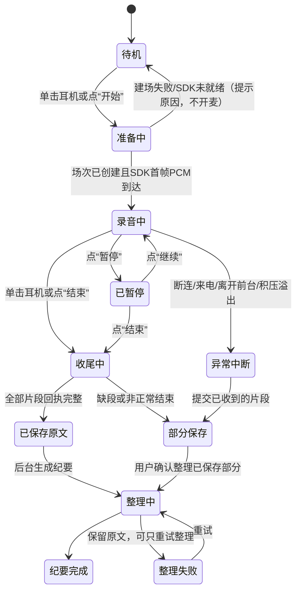

# 工作模式录音与工作纪要：竞品调研与方案

调研日期：2026-10-17。源码基线：`feature/ux-fixes-and-ai-prompt` @ `5da427c`。本文是调研结论和设计建议，**不是已实现功能、API 契约或验收记录**。本轮未修改代码，也未部署。

证据标签：

- 【截图】用户提供的截图中可见。**本轮对话未收到任何截图**，所以全文没有这一类结论，见第 2 节。
- 【官方】已在官方页面或帮助文档核实，附链接。
- 【第三方】新闻、评测或搜索摘要，未经官方确认。
- 【代码】已在本仓库源码或文档中确认。
- 【建议】本文的设计建议。
- 【待验证】需要真机、供应商或法务确认。

调研方式说明：本轮 WebSearch 和 WebFetch 均因模型配置错误不可用，所以官方页面全部通过内置浏览器直接打开并读取。第三方评测只看到了搜索结果摘要，没有逐篇阅读。

---

## 0. 最有价值的结论

1. **Aidol 已经具备“单场会议”骨架，缺的是“时间轴”和“音频”。**【代码】现有工作模式可以完成开始、持续录音、每 20 秒分段转写、结束排空、按场保存原文，并在后台生成带原文引用的标题、摘要、议题、决策、待办和待确认事项（`app/services/work_meetings.py`、`/v1/work-meetings*`）。缺少的是：录音内相对时间戳、暂停/继续、标记重点、说话人、音频保存与回听、章节。
2. **第一个要拍板的决定是“是否保存原始音频、存在哪里”。**这一项决定回听、点击定位播放和整场说话人分离能不能做。【代码】目前原始 PCM 只在内存中处理，不落盘。【官方】火山“录音文件识别标准版”支持说话人聚类（`enable_speaker_info`）和双声道识别（`enable_channel_split`），但请求要求提供可访问的音频 `url`。因此不保存音频，就只能做到“文字 + 相对时间戳”。
3. **相对时间戳不依赖保存音频，可以立即做。**【代码】Android 每段正好切 20 秒 PCM（`WorkAudioBuffer.SEGMENT_BYTES = 20 * 32000`），ASR 已请求 `show_utterances`。【官方】火山返回的句子带毫秒级 `start_time`/`end_time`。所以句子时间可以写成 `段号 × 20 秒 + 句内偏移`，目前这些时间被丢弃了。【建议】放进 MVP。
4. **说话人要分三步做，MVP 不做真实身份识别。**【建议】依次是：通道区分（如“我方麦克风/通话对方”，仅在 SDK 实测确认后启用）→ 整场匿名聚类“说话人 1/2/…”→ 用户手动命名。声纹识别真实身份属于《个人信息保护法》第 28 条所列的生物识别敏感个人信息，按第 29 条需单独同意，不进入 MVP。
5. **不能默认耳机能清楚录到房间里的所有人。**【官方】安克自己的 AI 会议耳机，通话靠耳机录，线下面对面则用充电盒录（手册写明“充电盒录音纪要”）。【代码】Rise SDK 的融合录音返回“扬声器（channel 1）+ 麦克风（channel 2）”两路，并且有通话录音、线下录音、闪录和 TAG 打点接口。但每个接口在目标 Rise 型号上的实际内容，尤其 channel 1 在电话或网络会议中是否带有对方声音，【待验证】。
6. **Android 普通应用不能录系统电话。**【官方】`VOICE_CALL/UPLINK/DOWNLINK` 需要系统保留权限 `CAPTURE_AUDIO_OUTPUT`。`AudioPlaybackCapture` 只能捕获 `USAGE_MEDIA/GAME/UNKNOWN`，捕获不到 VoIP 通话常用的 `USAGE_VOICE_COMMUNICATION`。所以通话或线上会议的双向录音只能走厂商 SDK 或固件这一条路，并且必须实测和过法务。
7. **需求里写的“通信模式”在代码里不存在。**【代码】现有三种模式是生活 `life`、工作 `work`、通勤 `commute`。需要确认“通信”是“通勤”的笔误，还是要新增“通话/通信”模式（见第 8 节问题 2）。这决定通话录音应放进工作模式，还是单独成为一个模式。

---

## 1. 目标理解与关键假设

**目标**：在工作模式下，让用户通过耳机和 Android App 完成一条完整链路：开始录音 → 录音中标记重点 → 结束保存 → 查看逐字稿（含时间、说话人）→ 获得摘要、章节、决策、待办 → 从文字或摘要依据回到原文和原声。

**影响方案的关键假设**（全部可推翻）：

| # | 假设 | 若不成立的影响 |
| --- | --- | --- |
| A1 | “安克”指安克创新（Anker），相关产品为下文三款。研究重点是与飞书深度集成的“安克 AI 录音豆”和“安克 AI 会议耳机”，海外版 Soundcore Work 作为对照 | 若指其他品牌，需重做第 3 节 |
| A2 | 首要场景是**佩戴者本人参与的线下会议或讨论**；电话和线上会议是第二阶段 | 若通话录音是首要场景，MVP 需要先完成 SDK 通话录音验证和法务评审 |
| A3 | 继续使用 Rise SDK 融合录音的麦克风通道作为唯一采集源，不并行开启手机麦克风 | 若允许手机麦克风作为“桌面麦”，远场多人效果可能更好，但要改动现有的采集互斥策略 |
| A4 | 火山引擎仍是 ASR 供应商，文字模型继续沿用现有配置 | 换供应商需要重新核对时间戳和说话人字段 |
| A5 | 用户主要在中国大陆使用，适用《个人信息保护法》 | 其他地区需另做法务评估，本文未核实 |
| A6 | 录音期间 App 可以保持前台；锁屏或后台录音是后续阶段 | 若 MVP 就要求锁屏长录音，需要提前做 `microphone` 类型前台服务 |

---

## 2. 四张截图：未收到，证据边界

**本轮对话中没有任何图片附件。**下文不对截图内容作任何描述，也不推断其品牌、版本或实现方式。请重新上传。收到后按下表逐项填写“截图中可见”一列，再与官方资料对照：

| 待拆解项 | 截图中可见（待填） | 区分点 | 官方资料中可对照的内容 |
| --- | --- | --- | --- |
| 总结 | — | 只是标题入口，还是能看到正文 | 【官方】飞书“智能纪要/会议纪要”可翻译、可编辑（[查看妙记](https://www.feishu.cn/hc/zh-CN/articles/022111234449)） |
| 智能章节 | — | 章节有没有时间戳、能不能点击 | 【官方】飞书产品页写有“结构化呈现章节纪要”（[智能会议纪要](https://www.feishu.cn/product/ai-meeting-summary)），未看到章节交互细节 |
| 关键决策 | — | 有没有原文依据或跳转 | 未在官方帮助文档中找到同名模块 |
| 金句时刻 | — | 是 AI 选出的还是用户标记的 | 【官方】录音豆与会议耳机支持“标记重点”并生成“我的笔记”，与“金句”是否同一功能【待验证】 |
| 相关链接 | — | 链接到什么（文档、日程） | 【官方】飞书“会议信息”区可看“相关链接” |
| 目录导航 | — | 目录里只是入口，还是对应功能已经展开可见 | — |
| 逐字稿说话人标签 | — | 显示真实姓名还是“说话人 N”；能不能改名 | 【官方】飞书重新识别后显示“说话人 1/2/3”，可手动改名 |
| 逐字稿时间戳 | — | 是绝对时间还是录音内相对时间；粒度是段落、句子还是词 | 【官方】飞书点击文字记录可定位到对应视频位置 |

---

## 3. 竞品对比

产品与型号核实结果：

- **安克 AI 录音豆**：安克创新与飞书联合推出，App 为**飞书**（妙记），要求飞书 V7.60+。【官方】[产品使用说明](https://www.feishu.cn/hc/zh-CN/articles/445044627145)、[更新日志](https://www.feishu.cn/hc/zh-CN/articles/782231437841)。帮助文档未写硬件型号。【第三方】售价 899 元，2026-01 上市（来自搜索摘要）。
- **安克 AI 会议耳机（Liberty 5 Pro Max）**：飞书版，App 同样是飞书，要求 V7.75+，充电盒录音需 V7.77+ 且充电盒固件 V5.00+。【官方】[产品使用说明](https://www.feishu.cn/hc/zh-CN/articles/693568725551)。【第三方】2026-10-12 开售，1799 元。
- **Anker soundcore Work（型号 D3200）**：海外 AI 录音器，App 为 soundcore App，另有网页 Online Hub。【官方】[产品页](https://www.soundcore.com/products/d3200-soundcore-work-ai-voice-recorder)。它与“录音豆”是不同产品线，不能混为一谈。
- **飞书妙记**：软件平台，上面两款飞书版硬件的转写、纪要都由它承载。【官方】[生成妙记](https://www.feishu.cn/hc/zh-CN/articles/386045971891)、[查看妙记](https://www.feishu.cn/hc/zh-CN/articles/022111234449)、[重新识别说话人](https://www.feishu.cn/hc/zh-CN/articles/812241214493)。

| 维度 | 飞书妙记（软件） | 安克 AI 录音豆（飞书） | 安克 AI 会议耳机 Liberty 5 Pro Max（飞书） | soundcore Work D3200 |
| --- | --- | --- | --- | --- |
| 录音流程 | 【官方】四种来源：会议云录制、App 内录音、上传本地文件、导入云端文件。录音可**暂停/继续**，移动端可缩成浮窗继续录，可邀请协作者实时看转写 | 【官方】单击开始、再单击结束，有震动和橙灯反馈。录音豆连着手机时可边录边转；离线录音的文件在连接后经蓝牙或 Wi‑Fi 自动传到飞书，传完从设备删除 | 【官方】通话中双击耳机开始/结束“通话录音”，耳机播报“开始录音”；通话结束自动停止；未连飞书时播报“请连接飞书”。线下面对面用**充电盒**录：双击盒键或在屏幕菜单开始，支持暂停 | 【官方】单击开始，**双击标记重点**（有震动确认）。iOS 自动拉起 App，停止后立即上传；Android 需要开启后台权限 |
| 转写 | 【官方】实时转写，自动识别中、英、日等语言，可翻译 | 【官方】实时转写、AI 实时总结；中英日自动识别，24 种语言实时翻译 | 【官方】实时转写、AI 实时总结；中、英、日、粤 4 种自动识别，24 种语言翻译 | 【官方】宣称最高 97% 准确率，150+ 种语言，12+ 行业术语库 |
| 说话人 | 【官方】会议室设备会自动拆分说话人；多人共用一台个人设备时，可在桌面端“重新识别说话人”并指定人数，结果显示“说话人 1/2/3”，可手动改名。仅限创建 30 天内的妙记 | 官方帮助文档未单独说明 | 官方帮助文档未单独说明 | 【官方】写的是 “speaker identification”，没有说明这是匿名分离还是身份识别【待验证】 |
| 时间戳与定位 | 【官方】点击任意文字记录可定位到对应视频位置；发言人时间轴可以点击定位；可“跳过空白片段” | 【官方】标记重点会记录时刻，AI 总结标记附近的内容 | 【官方】充电盒录音可用“旗帜”图标标注重点 | 【官方】双击高亮，摘要中把高亮置顶 |
| 总结 | 【官方】智能纪要（权益相关）、章节纪要、智能识别待办、会中实时总结 | 【官方】录完自动生成智能纪要文档，由“智能纪要助手”推送；可“知识问答” | 【官方】智能纪要；“豆包工作”可基于纪要问答 | 【官方】结构化摘要（要点、决策、跟进）、自适应模板、Ask AI |
| 编辑与导出 | 【官方】编辑文字记录和纪要、高亮、评论、创建片段、导出文字记录、下载音频或视频；权限由所有者设置 | 依托妙记；“保存笔记”开关打开后生成“我的笔记” | 【官方】设置中可选“保留音频”或“仅保留文字” | 【官方】网页端可读、编辑并播放音频 |
| 限制 | 【官方】基础版转写有额度上限；占用企业存储空间 | 【官方】一个账号只能绑定一台设备；加入飞书会议时暂停实时转写；解绑会清除未同步文件 | 【官方】一个账号绑一台设备；通话录音期间不能用飞书手机录音；双耳录音续航大于 3 小时 | 【官方】每月免费 300 分钟，Pro 1200 分钟；Find My 仅限 iPhone |
| 隐私 | 未在本轮阅读的页面中核实 | 未核实 | 【官方】可选只保留文字 | 【官方】默认本地 AES‑256 加密存储；云端转写后立即删除，未取回的文件最多暂存 7 天（关闭云存储时适用）；SOC 2 Type I |

**对我们最有参考价值的三点**：

1. **重点标记是共识。**三款硬件都有“录音中一键标记重点”，而且标记会进入总结。【建议】Aidol 应该在耳机上提供同样的操作，见第 4、5 节的手势冲突说明。
2. **安克会议耳机把“通话录音”和“线下录音”分给了不同硬件。**线下面对面用的是充电盒，不是耳机麦克风。这印证了结论 5：耳机麦克风主要服务佩戴者本人。
3. **飞书把“说话人”做成可修正的结果。**允许重新识别、指定人数、手动改名，而不是承诺自动识别出真实身份。

---

## 4. 推荐用户流程与核心页面

### 4.1 完整流程与状态



| 阶段 | 用户看到的反馈 | 失败与恢复 | 现状 |
| --- | --- | --- | --- |
| 入口与开始 | 工作页大按钮或耳机单击；先播“开始录音”提示，再开麦 | 建场失败或 SDK 未就绪时不开麦，提示原因 | 【代码】已有 |
| 录音中 | 计时、实时电平、已转写片段数、待提交队列、标记数 | 断连、来电或离开前台时停止并提交已采集部分，标为“部分保存” | 【代码】已有，暂停与标记除外 |
| 暂停/继续 | 计时冻结，显示“已暂停 hh:mm:ss” | 暂停时关闭 SDK 采音还是只丢弃数据，【待验证】SDK 重启耗时；【建议】暂停时停止 SDK 采音 | 未实现 |
| 结束/保存 | “正在保存最后一段”→“原文已保存 N 段” | 缺段时显示“部分保存”，列出缺失时间段；未确认的段不自动重放 | 【代码】已有 |
| 上传/转写 | 每段转写结果实时追加 | 单段失败可用同一 request_id 重试 | 【代码】已有 |
| 总结 | “AI 整理中 2/5”进度条 | 失败时保留原文，可只重试整理 | 【代码】已有 |
| 编辑 | 改正逐字稿文字、说话人名、纪要条目 | 编辑不改原始 ASR，另存修订版本 | 未实现 |
| 检索 | 场次列表搜索标题和全文；详情页内搜索 | — | 【代码】有 FTS5 全量记忆检索，会议内搜索未做 |
| 分享/导出 | 导出 Markdown/TXT（含时间与说话人）；复制纪要 | 【建议】MVP 不做公开分享链接 | 【代码】有 `/v1/export` v4 全量导出 |
| 删除 | 删除整场（原文、纪要、待办、音频），或只删音频 | 二次确认；删除后不可恢复 | 【代码】有原文遗忘的级联；整场删除入口【待确认】 |

### 4.2 页面说明

**① 工作模式入口（待机）**

- 内容：耳机连接与佩戴状态；“开始记录”大按钮；最近 3 场会议卡片（标题、日期时间、时长、整理状态）；一行常驻的隐私说明，例如“录音会上传转写，请告知在场人员”。
- 操作：开始、进入历史、搜索。
- 异常：耳机未就绪时按钮置灰并说明原因；ASR 能力缺失时不允许开始（现有规则）。

**② 录音中**

- 内容：大号计时（录音内相对时间，不含暂停）、开始的实际时间，例如“14:03 开始”、音量电平、实时转写流（显示“说话人”前先显示时间）、标记数、网络与待提交队列状态。
- 操作：暂停/继续、结束、**标记重点**（手机按钮与耳机手势）、可选地给标记加一句备注。
- 耳机与手机分工【建议】：耳机只承担“开始/结束/标记”这类盲操作；暂停、备注、查看转写放在手机上。
- 误触：【代码】现有耳机单击有 400ms 组合判定和去重。【建议】“结束”加一道防护：耳机单击结束后先播“已结束，正在保存”，3 秒内再次单击可撤销；手机端结束按钮需要长按或二次确认。
- **手势冲突**：【代码】当前录音中双击 = “结束并切换模式”，而三款竞品都把双击用作“标记重点”。【建议】工作模式录音中，双击改为标记，模式切换只在待机状态下允许。这会改变现有的耳机交互约定，需要你确认（问题 5）。
- 断连、来电、断网、后台：【代码】断连、来电或离开前台会结束并提交；网络积压超过 6 段（2 分钟）时提示未完整保存。【建议】长录音时，在手机本地缓存待提交的 PCM 或编码音频，避免断网 2 分钟就失败（依赖问题 1 的音频策略）；后台录音进入 P2，需要 `microphone` 类型前台服务。
- 长录音：【建议】每 30 分钟在通知栏刷新一次时长与剩余电量；耳机电量 ≤20% 时提示（现有电量分级可复用）。

**③ 处理中**

- 内容：原文立即可看；顶部显示进度条，依次为“原文已保存 → 时间轴整理 → 说话人整理（P1）→ AI 纪要”，每一步独立显示成功或失败。
- 操作：可直接复制原文；失败的步骤单独重试。
- 规则【代码】：无讲话显示为 `empty`，缺段显示为 `partial`，不能显示“完整保存”。

**④ 纪要详情**（建议采用 Tab 结构）

- 头部：标题（可编辑）、实际日期时间（如“2026-10-17 14:03:12–15:10:40，时长 58:20，暂停 9 分钟”）、说话人数、整理状态与“AI 整理稿，请核对原文”提示。
- Tab“纪要”：摘要 → 决策 → 待办（负责人、截止时间、依据）→ 待确认事项 → 我的标记 → 章节（P1）。每一条都带“依据”角标，点开显示引用的原文句子和时间，点击跳到逐字稿对应位置；保存了音频时同时从该时间开始播放。
- Tab“逐字稿”：按句子显示 `[00:12:31] 说话人 2：……`；可以搜索、编辑和高亮；暂停处插入分隔条“暂停 5 分钟（14:15:30–14:20:30）”。
- 音频条（P1）：播放/暂停、倍速、拖动；播放时同步高亮当前句子。
- 操作：导出、删除整场或只删音频、重试整理。

**⑤ 说话人管理（P1）**

- 列表：每位说话人的标签、发言时长占比、前两句样例（保存了音频时可试听）。
- 操作：改名（只作用于本场）、合并两位说话人、把单句改派给别人、按指定人数重新分离（需要保存音频）。
- 文案原则：显示“说话人 1”，而不是“未知用户”；改名后显示“张三（手动命名）”；不出现“已识别为张三”这类措辞。

### 4.3 时间戳设计

| 时间 | 用途 | 来源 | 建议 |
| --- | --- | --- | --- |
| 录音实际日期时间 | 列表排序、和日程或现实事件对照 | 每次开始或继续时记录手机墙钟，同时保存时区 | 【建议】每段连续录音（run）各存一份开始时间 |
| 录音内相对时间 | 回听定位、引用、章节 | **由 PCM 字节数换算**：16 kHz × 2 B = 32 B/ms；不用墙钟推算（网络延迟、暂停都会让墙钟失真） | 【建议】暂停期间相对时间不前进；在 run 的边界插入暂停标记 |
| 句子时间戳 | 点击定位、说话人、引用粒度 | 段起点 + ASR utterance `start_time/end_time` | 【建议】MVP 存句子级 |
| 词级时间戳 | 播放时逐词高亮、精准剪片 | ASR `words` | 【建议】P2，数据量大，按需开启 |
| 章节时间戳 | 目录跳转 | 章节所引句子的最早开始时间 | 【建议】由后端根据引用计算，不让模型直接输出时间，避免编造 |

**点击定位链路**：纪要条目 → `citation.utterance_ids` → 句子的 `start_ms` → 逐字稿滚动并高亮 →（若有音频）`player.seek(start_ms)`。没有音频时只做文字定位，界面上不显示播放按钮，不做“假定位”。

**20 秒硬切的问题**【代码】【建议】：现在按固定字节数切段，词语可能被从中间切开，段间也没有上下文。可选方案：(a) 在 18–22 秒窗口内找能量最低的帧切；(b) 保存音频后，结束时整场重识别一次，替换临时逐字稿（同时解决说话人分离的问题）。

### 4.4 说话人：四个概念不要混用

| 概念 | 回答的问题 | 结果形式 | Aidol 建议 |
| --- | --- | --- | --- |
| 语音转文字（ASR） | 说了什么 | 文字 + 时间 | 已有 |
| 说话人分离（diarization） | 哪些片段是**同一个人**说的 | 本场匿名标签“说话人 1/2…”，跨场不对应 | P1，整场处理 |
| 真实身份识别（声纹） | 这个人**是谁** | 绑定到某个已登记的人 | **不做**；生物识别敏感信息，需单独同意 |
| 人工命名 | 用户告诉系统这是谁 | “张三（手动命名）” | P1，与分离一起做 |

**“说话人 1/2”是怎么来的**：模型把语音切成小片段并提取声音特征，再按相似度聚类；类别编号只表示“同一类声音”，没有身份含义。【官方】火山标准版写明 `enable_speaker_info` 在 10 人以内效果较好，并提示“音频存在音量、远近等明显变化，无法保证区分效果”。耳机场景恰好如此：佩戴者声音近而响，其他人远而轻。

**难点处理**【建议】：

- **分段导致标签不一致**：如果每 20 秒单独分离，同一个人在不同段可能编号不同。所以分离必须在整场音频上做，这依赖保存音频。
- **多人同时说话**：归给主导声音，并在该句加“多人重叠”标记；不拆成两句伪造顺序。
- **短发言**（“嗯”“对”，小于 1 秒）：置信度低时并入相邻句或标为“未确定”，不单独新建说话人。
- **噪声**：非语音片段不分配说话人；噪声导致误分时，用户可以合并说话人。
- **通道法（优先于聚类）**：如果实测确认 SDK channel 1 在通话中带的是对方声音，可以把两路分别识别（火山 `enable_channel_split` 支持双声道标记），标为“我方麦克风 / 通话对方”。注意：“我方麦克风”也可能录到身边的人，不能直接标成“我”。

### 4.5 录音后处理与引用

- 组织顺序：摘要 → 决策 → 待办 → 待确认事项 → 我的标记 → 章节 → 逐字稿。
- 引用规则【代码】【建议】：现在 `source_ids` 指向的是 20 秒段落的转写 ID；建议改为指向句子 ID，由后端从句子算出时间段 `[start_ms, end_ms]`。如果模型引用了不存在的 ID，校验时丢弃该条（沿用 `_validate` 的做法）。
- 负责人与截止时间：只有原文明确出现时才填写。否则显示“负责人：未明确”“截止：未提及”，绝不推断；原文是“下周左右”这类模糊说法时，原样保留并加“原文表述”标记，不换算成日期。【代码】现有提示词已要求“已撤销承诺不能列为待办”。
- 我的标记：标记时刻前后各 30 秒的原文交给模型生成一句话要点；同时保留未经 AI 处理的原文片段。

### 4.6 耳机适配：声音从哪里来

| 声源 | 可能路径 | 普通蓝牙（HFP/SCO） | Android 系统限制 | Rise SDK | 必须真机验证 |
| --- | --- | --- | --- | --- | --- |
| 佩戴者语音 | 耳机麦克风 | 可用，但 SCO 通话音质与路由需逐机核对 | 普通 `RECORD_AUDIO` | 【代码】融合录音 channel 2（麦克风），16 kHz 单声道 | 清晰度、风噪、长时间稳定性 |
| 周围其他人 | 耳机麦克风（远场）；或手机麦克风作为桌面麦；或盒子 | 耳机降噪和波束成形可能主动压低他人声音 | 手机麦克风可用，但【代码】现有策略禁止它与 SDK 并行采集 | 【代码】文档有 Aura 盒子实时录音（`startLiveRecord`）；目标型号是否支持，【待验证】 | 1 m / 3 m / 5 m 距离下的可懂度；对方被识别的比例 |
| 电话通话双方 | 系统电话下行 + 麦克风上行 | 不能由第三方应用录取 | 【官方】`VOICE_CALL/UPLINK/DOWNLINK` 需要系统保留权限 | 【代码】文档有 `startCallRecord`（仅通话中）以及融合录音的“通话/媒体场景 + 扬声器通道” | channel 1 是否真的带对方声音、scene 取值含义、电话与 VoIP 是否都适用 |
| 线上会议音频（腾讯会议、飞书等） | App 播放到耳机的声音 | — | 【官方】`AudioPlaybackCapture` 捕获不到 `USAGE_VOICE_COMMUNICATION`，且需要用户授权屏幕捕获 | 同上：扬声器通道是否包含所有播放源，【待验证】 | 手机与电脑多点连接时，电脑会议的声音能否被录到 |

【待验证】Rise SDK 文档中的场景（scene）取值表是嵌入的图片表格，文本导出时丢失了。需要从原 docx 或厂商处取得。

### 4.7 数据与隐私

- **录音提示**【建议】：首次使用工作模式时弹出隐私说明（录音用途、供应商火山引擎、保存期限、删除方式），用户主动勾选后才能开始；之后每次开始都播耳机提示音（现有），手机显示常驻通知（录音中通知本身也是 Android 前台服务的要求）。对在场其他人的告知只能由用户本人完成，App 在开始页和录音中顶部提示“请告知在场人员”。
- **本地与云端**：【代码】现状是 PCM 只在手机内存里，按段上传后端，后端转发火山 ASR，文字存在用户的 UUID SQLite，音频不落盘。音频保存的三个选项见问题 1：A 不保存（现状）；B 只存在手机本地（可回听，但无法做云端整场分离，换机即丢失）；C 后端按账号保存（可回听、可整场分离，需要存储、加密和删除流程）。
- **保存期限**【建议】：文字默认一直保留到用户删除；音频提供“不保存 / 7 天 / 30 天 / 一直保留”，默认 30 天后自动删除音频、保留文字（参考飞书“保留音频或仅保留文字”的二选一）。
- **删除与导出**：整场删除时级联删除音频、句子、说话人、标记、纪要和待办；提供“只删音频”；导出 Markdown/TXT（带时间与说话人）。供应商侧是否留存数据、留存多久，需要核实火山的数据政策【待验证】。
- **多账号隔离**：【代码】沿用“鉴权 → 服务端 UUID 选库”。【建议】音频放在 `users/<UUID>/audio/<meeting_id>/`，路径完全由服务端生成，只能通过鉴权接口按范围读取；账号清空或删除时连同目录一起删除；备份策略要覆盖音频（`deploy/` 需要更新）。
- **法律依据**（仅限中国大陆，来源：[《个人信息保护法》全文，中国人大网](http://www.npc.gov.cn/npc/c2/c30834/202108/t20210820_313088.html)）：第 13、14 条（处理依据与知情同意；处理目的或方式变更需要重新同意）；第 15 条（可撤回同意，须提供便捷方式）；第 28 条（生物识别属于敏感个人信息）；第 29 条（敏感个人信息需单独同意）；第 47 条（目的实现、撤回同意、期限届满时应主动删除）。“录制他人谈话”在民事、劳动、证据等方面的合规边界，以及其他国家或地区的规则，本轮**没有核实**，需要法务确认。

---

## 5. MVP 与后续阶段

| 阶段 | 功能 | 用户价值 | 依赖 | 优先级 |
| --- | --- | --- | --- | --- |
| MVP | 句子级相对时间戳 + 实际开始时间 | 逐字稿可读、引用可以定位 | 后端保存 utterance；Android 不需要大改 | P0 |
| MVP | 暂停/继续（多段 run） | 会议中途休息时不必新开一场 | Android 状态机、后端 run 表；SDK 停止/重启耗时实测 | P0 |
| MVP | 录音中标记重点（手机按钮 + 耳机双击） | 竞品共识，最低成本获得“重点” | 手势冲突决策（问题 5）、后端 marks | P0 |
| MVP | 纪要条目带依据，点击跳到逐字稿 | 让 AI 结果可核对 | 引用从段落改到句子 | P0 |
| MVP | 待办负责人与截止时间显示“未明确” | 不编造 | 提示词与 UI | P0 |
| MVP | 会议内搜索、导出 Markdown、整场删除 | 基本可用性 | 已有导出能力，需补单场接口 | P0 |
| P1 | 音频保存 + 回听 + 点击句子或依据跳到对应时间播放 | 回听原声，竞品的标配 | **问题 1 的决定**；存储、加密、Range 读取、自动过期 | P1 |
| P1 | 整场说话人分离 + 改名、合并、改派 | 多人会议可读 | 保存音频；火山标准版需要可访问的 URL（当前测试 CA 证书大概率无法被供应商拉取，需要对象存储或正式证书）【待验证】 | P1 |
| P1 | 章节（带时间） | 长会议导航 | 句子时间戳 | P1 |
| P1 | 断网时本地缓存，恢复后补传 | 长录音可靠性 | 本地音频缓存 | P1 |
| P2 | 通话/线上会议双向录音（SDK 通道） | 远程会议场景 | SDK 实测、法务评审、可能还要独立的“通信模式” | P2 |
| P2 | 锁屏或后台长录音 | 手机可以放进口袋 | `microphone` 前台服务、系统回收后的恢复 | P2 |
| P2 | 会中实时总结、翻译、对录音提问 | 体验增强 | 已有翻译可行性文档、召回服务 | P2 |
| 不做 | 声纹身份识别、自动发送待办、公开分享链接 | — | 法律风险、产品边界 | — |

**不照搬的部分**：充电盒触屏、Wi‑Fi 快传、Find My、24 种语言翻译、“金句时刻”（若截图中有，建议先用“我的标记”覆盖这个需求，再看数据决定要不要做 AI 金句）。

---

## 6. 实现建议

### 6.1 职责划分

| 层 | 职责 |
| --- | --- |
| Android `HostedSession` 与 UI | 录音状态机（新增暂停）；按 PCM 字节数累计相对时间；把标记时刻换算为相对毫秒；（P1）本地编码缓存与补传；播放器 seek；第 4.2 节的五个页面 |
| Android `hardware/` | 融合录音两路数据的取舍与标注（channel 1/2）；scene 上报；手势事件；（P2）通话录音、盒子录音、闪录导入、TAG 打点。只接实测确认过的能力 |
| 后端 `app/main.py` / `storage.py` | 新表与迁移；run、标记、编辑、说话人改名的接口；音频按账号存储、按范围读取、过期删除 |
| 后端 `app/services/work_meetings.py` | 句子级引用、由引用算时间段、章节、标记摘要；在临时逐字稿与整场重识别结果之间做替换 |
| `app/providers/volc_speech.py` | 保留 utterances 的时间；（P1）接入录音文件识别标准版（说话人、双声道） |
| `docs/` | 修改契约时同步更新 `api.md`、`mode-experience.md`、`rise-controls.md`、`acceptance.md` |

### 6.2 数据关系（建议，非契约）

```mermaid
erDiagram
    WORK_MEETING ||--o{ RECORDING_RUN : "暂停切分"
    WORK_MEETING ||--o{ SEGMENT : "20秒上传单元"
    SEGMENT ||--o{ UTTERANCE : "ASR句子"
    WORK_MEETING ||--o{ SPEAKER : "本场匿名标签"
    SPEAKER ||--o{ UTTERANCE : "说话"
    WORK_MEETING ||--o{ MARK : "重点标记"
    WORK_MEETING ||--o| AUDIO_ASSET : "可选音频"
    WORK_MEETING ||--o{ REPORT_ITEM : "摘要/决策/待办/章节"
    REPORT_ITEM ||--o{ CITATION : "依据"
    CITATION }o--|| UTTERANCE : "引用句子"

    WORK_MEETING { text id; text started_at_wall; text timezone; int duration_ms; text status; text audio_policy }
    RECORDING_RUN { int run_index; text wall_start; text wall_end; int offset_start_ms; int offset_end_ms }
    SEGMENT { int segment_index; int offset_ms; int duration_ms; int channel; text request_id }
    UTTERANCE { text id; int start_ms; int end_ms; text asr_text; text edited_text; text speaker_id; bool overlap; text source }
    SPEAKER { text id; text label; text display_name; text origin; text merged_into }
    MARK { int offset_ms; text origin; text note }
    AUDIO_ASSET { text path; text codec; int bytes; text sha256; text expires_at }
    REPORT_ITEM { text kind; text text; text owner; text due; int start_ms }
```

要点：所有时间都存成“本场相对毫秒”，墙钟时间只存在 meeting 和 run 上；`UTTERANCE.asr_text` 不可修改，编辑写入 `edited_text`；`REPORT_ITEM.start_ms` 由后端从引用计算；`SPEAKER.origin` 取值为 `channel / diarization / manual`。

---

## 7. 验收清单

四类验收不能互相替代。记录写入 `docs/acceptance.md`，并注明构建号、手机型号和固件版本。

**本地模拟（pytest + Android 单元测试，mock 供应商）**

- [ ] 段号 × 20 秒 + 句内偏移的换算正确；尾段不足 20 秒时时间仍然正确。
- [ ] 暂停后相对时间不前进；run 边界和墙钟时间正确；暂停期间收到的迟到 PCM 被丢弃。
- [ ] 标记时刻换算为相对毫秒；耳机双击在录音中是“标记”，在待机时才切换模式（如采纳）。
- [ ] 纪要引用不存在的句子 ID 时，该条被丢弃；章节时间由后端计算。
- [ ] 负责人或截止时间在原文中缺失时，输出“未明确”。
- [ ] 删除整场后，各表与音频目录清空；跨账号访问他人会议或音频返回 404。
- [ ] 编辑逐字稿不改变 `asr_text`；导出内容带时间和说话人。

**真实供应商验证（`scripts/probe_*.py`，合成语音，会消耗额度）**

- [ ] 火山 flash 返回 utterance 的 `start_time/end_time`，与音频实际位置的误差小于 300 ms。
- [ ] 火山标准版 `enable_speaker_info`：两人、三人合成对话的分离正确率；音量差异大时的表现。
- [ ] `enable_channel_split`：双声道输入的 `channel_id` 标记正确。
- [ ] 供应商能拉取我们提供的音频 URL（证书、鉴权、有效期）。

**整链路验证（USB 真机 + 本地后端 + 真实供应商）**

- [ ] 30 分钟连续录音：无缺段，暂停与继续各 2 次，标记 5 次，结束后纪要可点击跳转。
- [ ] 断网 1 分钟、3 分钟：前者能补传，后者明确显示“部分保存”。
- [ ] 后端重启后，纪要整理能恢复，不会重复生成。
- [ ] （P1）点击句子后播放位置正确；只删音频后，界面不再显示播放入口。

**实体耳机验证（Rise 目标型号）**

- [ ] 佩戴者语音的转写准确率（安静环境与办公室噪声各一次）。
- [ ] 其他人在 1 m / 3 m / 5 m 距离说话时，内容能否被转写、说话人能否分开。
- [ ] 耳机单击开始/结束、双击标记的误触率与时延；摘下、断连、来电时的行为。
- [ ] 融合录音 channel 1 在系统电话、微信语音、腾讯会议中分别录到什么（只在获得通话双方同意的测试环境中进行）；scene 取值。
- [ ] 60 分钟录音的耳机电量消耗、发热和 SDK 稳定性。

---

## 8. 需要你确认的问题（按对可行性和设计的影响排序）

1. **原始音频保不保存、存在哪里？**（A 不保存 / B 只存在手机 / C 后端按账号保存，并设保存期限）这决定回听、点击播放和整场说话人分离能否实现，也决定存储、加密和备份的工作量。
2. **“通信模式”是“通勤模式”的笔误，还是新增一个“通话/通信”模式？**如果是新增，通话录音就要单独设计成一个模式，并先做 SDK channel 1 的实测和法务评审。
3. **首要场景是哪种？**佩戴者本人的笔记、线下多人会议，还是电话与线上会议？如果是线下多人会议，耳机远场拾音很可能不够，需要决定是否允许手机麦克风作为桌面麦（会改变现有的“SDK 与系统录音互斥”策略），或者等待盒子录音。
4. **目标硬件型号与固件**：Rise VI‑A10 是否支持文档中 Aura 系列的融合录音场景值、盒子实时录音和 TAG 打点？能否从厂商处拿到 scene 取值表？
5. **耳机手势**：工作模式录音中，是否把双击从“结束并切换模式”改为“标记重点”（与三款竞品一致）？
6. **MVP 是否必须支持锁屏或后台录音？**如果必须，前台服务和系统回收后的恢复要提前进入 MVP。
7. **使用地区与对象**：只面向中国大陆个人用户，还是也有企业或海外用户？这决定告知同意的文案与法务范围。
8. **请重新上传四张截图**，以便补全第 2 节，并核对“金句时刻”“相关链接”等模块是否需要做。
